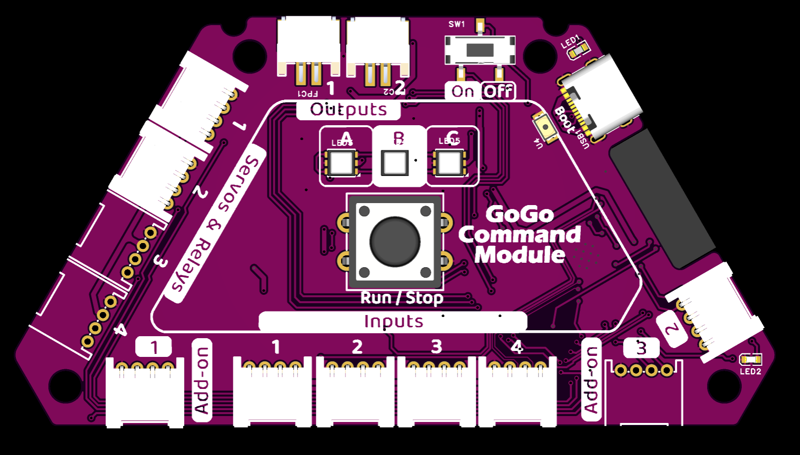
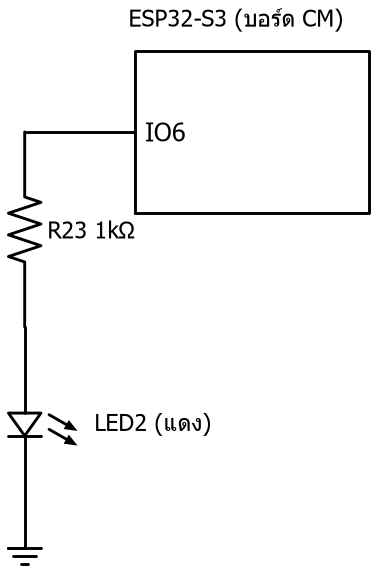
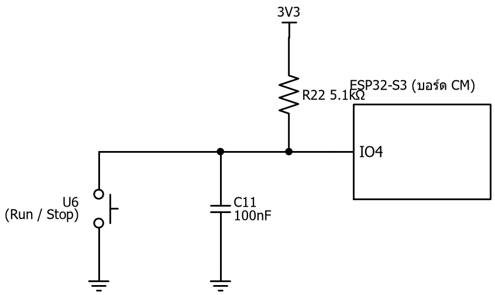

# LAB 1 - การใช้งาน Microcontroller เบื้องต้นบนบอร์ด GoGo Command Module (CM)

- [บอร์ด CM ต่างจาก ESP32 ในชุด Lab อย่างไร](#บอร์ด-cm-ต่างจาก-esp32-ในชุด-lab-อย่างไร)
  - [ESP32 กับ ESP32-S3](#esp32-กับ-esp32-s3)
  - [ขาที่ใช้ในแต่ละแพลตฟอร์ม](#ขาที่ใช้ในแต่ละแพลตฟอร์ม)
- [สิ่งที่ควรจะได้](#สิ่งที่ควรจะได้)
- [การเตรียมบอร์ด CM](#การเตรียมบอร์ด-cm)
- [LAB 1.1 — Hello World](#lab-11--hello-world)
- [LAB 1.2 — ไฟกระพริบ](#lab-12--ไฟกระพริบ)
- [LAB 1.3 — ควบคุมการทำงานของไฟด้วยปุ่มกด](#lab-13--ควบคุมการทำงานของไฟด้วยปุ่มกด)
  - [1.3.1 ใช้ปุ่มควบคุม LED แบบกดติด ปล่อยดับ](#131-ใช้ปุ่มควบคุม-led-แบบกดติด-ปล่อยดับ)
  - [1.3.2 นับจำนวนครั้งที่กดปุ่ม](#132-นับจำนวนครั้งที่กดปุ่ม)
  - [1.3.3 Bounce และวงจร Debounce บนบอร์ด](#133-bounce-และวงจร-debounce-บนบอร์ด)
- [ประเมินตนเอง](#ประเมินตนเอง)
- [สิ่งที่ต้องส่ง](#สิ่งที่ต้องส่ง)

ชีทนี้ทำกิจกรรมเดียวกับ [LAB 1 บน Breadboard](1%20MCU%20breadboard%20circuit.md) แต่ใช้บอร์ด GoGo Command Module (CM) ซึ่งมี LED และปุ่มกดติดตั้งอยู่บนบอร์ดแล้ว

บอร์ด CM ใช้ชิป **ESP32-S3** ซึ่งเป็นคนละรุ่นกับ **ESP32** ในชุด Lab และในโครงงาน Final Project
จุดประสงค์ของชีทนี้จึงไม่ใช่แค่ทำ Lab ให้ได้ผลเหมือนกัน แต่ให้เห็นว่า **Microcontroller ต่างรุ่นกัน แม้จะชื่อคล้ายกัน ก็มีรายละเอียดที่ต่างกัน** และต้องตรวจสอบทุกครั้งที่เปลี่ยนชิปหรือเปลี่ยนบอร์ด


*ตำแหน่งที่ใช้ในชีทนี้: LED2 สีแดง (มุมขวาล่าง) ต่อกับ IO6 · ปุ่ม Run / Stop (ปุ่มใหญ่กลางบอร์ด, U6) ต่อกับ IO4 · ปุ่ม Boot (U4) ข้างช่อง USB-C · สวิตช์ On / Off (SW1) · ช่อง Servos & Relays หมายเลข 1 ต่อกับ IO15*

## บอร์ด CM ต่างจาก ESP32 ในชุด Lab อย่างไร

### ESP32 กับ ESP32-S3

| | ESP32 (ชุด Lab, Wokwi, Final Project) | ESP32-S3 (บอร์ด CM) |
|---|---|---|
| การต่อ USB | ผ่านชิป USB-to-Serial บนบอร์ด (เช่น CP210x หรือ CH340) ต้องติดตั้ง Driver | ชิปมี USB ในตัว (Native USB) ไม่ต้องติดตั้ง Driver |
| เลือกบอร์ดใน Arduino IDE | ESP32 Dev Module | ESP32S3 Dev Module |
| Serial Monitor | ใช้ได้ทันที | ต้องตั้ง USB CDC On Boot เป็น Enabled |
| ขาที่ห้ามใช้ | GPIO6–11 ต่อกับหน่วยความจำ Flash ภายในโมดูล | GPIO6–11 ใช้ได้ตามปกติ (Flash ใช้ขาชุดอื่น) |
| Strapping pin (ขาที่มีผลตอนเปิดเครื่อง) | GPIO0, 2, 5, 12, 15 | GPIO0, 3, 45, 46 |
| DAC (ส่งสัญญาณแอนะล็อกออก) | มี 2 ช่อง (GPIO25, 26) | ไม่มี |
| Bluetooth | Classic และ BLE | BLE อย่างเดียว |

**ตัวอย่างที่เห็นได้ชัดที่สุดคือ LED:** บนบอร์ด CM ผู้ออกแบบต่อ LED ไว้ที่ IO6 ซึ่งใช้ได้บน ESP32-S3 แต่ถ้าเขียนโปรแกรมให้ ESP32 ในชุด Lab ใช้ GPIO6 โปรแกรมจะไปรบกวนการอ่าน Flash และบอร์ดจะทำงานผิดพลาด ชุด Lab จึงใช้ GPIO23 แทน

### ขาที่ใช้ในแต่ละแพลตฟอร์ม

| | Wokwi | Breadboard (ESP32) | บอร์ด CM (ESP32-S3) |
|---|---|---|---|
| LED | GPIO23 | GPIO23 | **IO6** — LED2 สีแดง (มุมขวาล่าง) ต่อผ่าน R23 1kΩ บนบอร์ด |
| ปุ่มกด | GPIO4 | GPIO4 | IO4 — ปุ่ม Run / Stop (U6) บนบอร์ด |
| ตัวต้านทาน Pull-up | ต่อเอง (หรือใช้ Internal Pull-up) | ต่อเอง 10kΩ | R22 5.1kΩ บนบอร์ด |
| วงจร Debounce | จำลองด้วยตัวเลือก Bounce ของปุ่ม | ต่อเองใน LAB 1.3.3 (33kΩ + 100nF) | C11 100nF บนบอร์ด |

โปรแกรมทุกข้อในชีทนี้เหมือนกับชีท Breadboard ยกเว้นบรรทัด `#define LED`

## สิ่งที่ควรจะได้

- ตั้งค่า Arduino IDE ให้ใช้กับ ESP32-S3 ได้ และอธิบายได้ว่าทำไมต้องตั้งต่างจาก ESP32
- เขียนโปรแกรมควบคุม LED และอ่านปุ่มกดบนบอร์ดที่มีวงจรสำเร็จรูป
- อ่านวงจร Pull-up และวงจร Debounce จาก Schematic ของบอร์ด และคำนวณค่าคงที่เวลา (Time constant) ได้
- อธิบายได้ว่าขาที่ใช้ได้ขึ้นกับรุ่นของชิป และต้องตรวจสอบจาก Datasheet ทุกครั้ง

## การเตรียมบอร์ด CM

1. ต่อสาย USB-C จากคอมพิวเตอร์เข้ากับบอร์ด CM แล้วเลื่อนสวิตช์ SW1 ไปที่ On
2. เปิด Arduino IDE (ติดตั้งส่วนขยาย ESP32 ตาม[คู่มือการเตรียมอุปกรณ์และโปรแกรม](1%20MCU%20Setup.md) — **ไม่ต้องติดตั้ง Driver CP210x** สำหรับบอร์ดนี้)
3. ตั้งค่าที่เมนู Tools:
   - Board: **ESP32S3 Dev Module**
   - USB CDC On Boot: **Enabled** — ถ้าไม่ตั้งค่านี้ ข้อความจาก `Serial` จะไม่ออกทาง USB และ Serial Monitor จะว่างเปล่า
   - Flash Size: **8MB**
   - PSRAM: **QSPI PSRAM**
   - Port: เลือก Port ของบอร์ด
4. **ถ้าอัปโหลดโปรแกรมไม่สำเร็จ หรือหา Port ไม่เจอ:** บอร์ด CM ไม่มีปุ่ม Reset ให้เข้าโหมดอัปโหลดเอง โดย
   - กดปุ่ม Boot (ปุ่มเล็ก U4 ข้างช่อง USB-C) ค้างไว้
   - เลื่อนสวิตช์ SW1 ไปที่ Off แล้วกลับมาที่ On
   - ปล่อยปุ่ม Boot แล้วกดอัปโหลดอีกครั้ง
   - เมื่ออัปโหลดเสร็จ ให้เลื่อนสวิตช์ SW1 Off แล้ว On เพื่อเริ่มโปรแกรม

## LAB 1.1 — Hello World

ใช้โปรแกรมเดียวกับชีท Breadboard

```cpp
void setup() {
  Serial.begin(9600);  // start serial communication
}

void loop() {
  Serial.println("Hello World!");
  delay(1000);  // wait 1000 ms
}
```

อัปโหลดโปรแกรม แล้วเปิด Serial Monitor ควรเห็นข้อความ “Hello World!” ทุก 1 วินาที

**คำถาม:** ใน ESP32-S3 ที่ใช้ Native USB ค่า 9600 ใน `Serial.begin(9600)` ยังมีความหมายอยู่หรือไม่ ลองเปลี่ยน Baud rate ใน Serial Monitor เป็นค่าอื่นแล้วสังเกตผล เทียบกับบอร์ด ESP32 ในชุด Lab

## LAB 1.2 — ไฟกระพริบ

LED บนบอร์ด CM ต่ออยู่ที่ IO6 ผ่านตัวต้านทาน R23 1kΩ — ไม่ต้องต่อวงจรเพิ่ม



```cpp
#define LED  6          // ESP32 ในชุด Lab ใช้ 23
#define DELAY_TIME  1000

void setup() {
  pinMode(LED, OUTPUT);
}

void loop() {
  digitalWrite(LED, HIGH);   // turn the LED on
  delay(DELAY_TIME);
  digitalWrite(LED, LOW);    // turn the LED off
  delay(DELAY_TIME);
}
```

**คำถาม:**

- ถ้านำโปรแกรมนี้ (LED = 6) ไปใช้กับบอร์ด ESP32 ในชุด Lab จะเกิดอะไรขึ้น เพราะอะไร (ให้ตอบจากตารางเปรียบเทียบด้านบน ไม่ต้องทดลองจริง)
- ขา IO6 ของบอร์ด CM ไม่มีจุดต่อออกมาภายนอก ถ้าต้องการวัดสัญญาณด้วย Logic Analyzer จะทำได้อย่างไร

**(ทางเลือก) วัดสัญญาณด้วย Logic Analyzer:** ให้โปรแกรมส่งสัญญาณเดียวกันออกอีกขาหนึ่งที่มีช่องต่อ เช่น IO15 ซึ่งต่อกับช่อง Servos & Relays หมายเลข 1 แล้วต่อสายสัญญาณ (สีเหลือง) และ GND (สีดำ) ของช่องนั้นเข้ากับ Logic Analyzer **ห้ามต่อสายสีแดง** ซึ่งเป็นไฟเลี้ยง Servo

```cpp
#define PROBE  15   // ช่อง Servos & Relays หมายเลข 1
// ใน setup():  pinMode(PROBE, OUTPUT);
// ใน loop() ให้สั่ง digitalWrite(PROBE, ...) คู่กับ digitalWrite(LED, ...) ทุกครั้ง
```

## LAB 1.3 — ควบคุมการทำงานของไฟด้วยปุ่มกด

### 1.3.1 ใช้ปุ่มควบคุม LED แบบกดติด ปล่อยดับ

ปุ่ม Run / Stop (ปุ่มใหญ่กลางบอร์ด, U6) ต่ออยู่ที่ IO4 พร้อมตัวต้านทาน Pull-up R22 5.1kΩ และตัวเก็บประจุ C11 100nF บนบอร์ด



```cpp
#define LED     6
#define BUTTON  4

void setup() {
  pinMode(BUTTON, INPUT);   // บอร์ดมี Pull-up (R22) อยู่แล้ว
  pinMode(LED, OUTPUT);
}

void loop() {
  if (digitalRead(BUTTON) == LOW) {
    digitalWrite(LED, HIGH);
  } else {
    digitalWrite(LED, LOW);
  }
}
```

**อ่านวงจรจาก Schematic** (บนบอร์ด CM ต่อวงจรเองไม่ได้ จึงต้องอ่านวงจรแทน):

- ชี้ตำแหน่ง R22 ในวงจร และอธิบายว่าทำไมเมื่อไม่กดปุ่ม IO4 จึงอ่านได้ HIGH และเมื่อกดจึงอ่านได้ LOW
- **Internal Pull-up:** ถ้าเปลี่ยนเป็น `pinMode(BUTTON, INPUT_PULLUP);` ผลจะเปลี่ยนหรือไม่ เพราะอะไร และทำไมผู้ออกแบบบอร์ดยังใส่ R22 ไว้ ทั้งที่ชิปมี Internal Pull-up
- **Pull-down:** ถ้าต้องการเปลี่ยนวงจรนี้เป็นแบบ Pull-down ต้องย้าย R22 และต่อปุ่มอย่างไร และต้องแก้โปรแกรมตรงไหน (วาดวงจรประกอบคำตอบ)

### 1.3.2 นับจำนวนครั้งที่กดปุ่ม

เหมือนชีท Breadboard: ต่อยอดโปรแกรมเดิมให้นับเพิ่ม 1 ทุกครั้งที่กดปุ่ม และพิมพ์ค่าออกทาง Serial Monitor
ต้องนับแค่ครั้งเดียวต่อการกดหนึ่งครั้ง แม้จะกดปุ่มค้างไว้

### 1.3.3 Bounce และวงจร Debounce บนบอร์ด

ในชีท Breadboard นักศึกษาต้องต่อวงจร Debounce (R3 33kΩ และ C1 100nF) เพิ่มเอง แต่บอร์ด CM มีวงจรนี้ในตัวแล้ว คือ R22 และ C11

1. คำนวณค่าคงที่เวลา τ = R × C ของวงจรบนบอร์ด CM (R22 5.1kΩ, C11 100nF) และของวงจรในชีท Breadboard (R3 33kΩ, C1 100nF)
2. วงจรทั้งสองต่างกันอย่างไร: บนบอร์ด CM เมื่อกดปุ่ม ตัวเก็บประจุ C11 คายประจุผ่านปุ่มโดยตรง ส่วนเมื่อปล่อยปุ่ม C11 อัดประจุผ่าน R22 ให้อธิบายว่าวงจรนี้ช่วยลด Bounce ได้อย่างไร
3. ใช้โปรแกรมนับจำนวนครั้งจาก 1.3.2 กดปุ่ม 20 ครั้ง แล้วดูว่าโปรแกรมนับได้กี่ครั้ง เทียบกับผลการทดลอง Bounce ใน Wokwi หรือ Breadboard
4. (ทางเลือก) ใช้วิธีส่งสัญญาณออกขา IO15 แบบใน LAB 1.2 เพื่อดูสถานะปุ่มที่โปรแกรมอ่านได้ใน Logic Analyzer — สังเกตว่าวิธีนี้แสดงค่าที่**โปรแกรมอ่านได้** ไม่ใช่แรงดันจริงที่ขา IO4

## ประเมินตนเอง

- ตั้งค่า Arduino IDE สำหรับ ESP32-S3 ได้ และอธิบายได้ว่าทำไมต้องเปิด USB CDC On Boot
- อธิบายได้ว่าทำไมบอร์ด CM ใช้ LED ที่ IO6 ได้ แต่ ESP32 ในชุด Lab ใช้ GPIO6 ไม่ได้
- โปรแกรมนับจำนวนครั้งทำงานถูกต้อง ไม่นับรัวเวลากดปุ่มค้าง
- อ่าน Schematic แล้วชี้ได้ว่าส่วนใดเป็น Pull-up และส่วนใดเป็นวงจร Debounce พร้อมคำนวณ τ ได้
- เปรียบเทียบได้ว่าการต่อวงจรเองบน Breadboard กับการใช้บอร์ดสำเร็จรูป มีข้อดีข้อเสียอย่างไร

## สิ่งที่ต้องส่ง

1. LAB 1.1 — ภาพหน้าจอ Serial Monitor แสดง “Hello World!” และคำตอบเรื่อง Baud rate
2. LAB 1.2 — วิดีโอสั้นหรือภาพ LED กระพริบ และคำตอบทั้งสองข้อ (ถ้าทำทางเลือก ส่งภาพจาก Logic Analyzer ด้วย)
3. LAB 1.3.1 — คำตอบจากการอ่านวงจร (Pull-up, Internal Pull-up, Pull-down พร้อมภาพวาดวงจร)
4. LAB 1.3.2 — โค้ด และภาพหน้าจอ Serial Monitor แสดงการนับ
5. LAB 1.3.3 — ค่า τ ของทั้งสองวงจร คำอธิบายการทำงานของวงจร Debounce และผลการกดปุ่ม 20 ครั้ง

## สัญญาอนุญาต (License)


ผลงานนี้เผยแพร่ภายใต้สัญญาอนุญาต  
**Creative Commons Attribution–ShareAlike 4.0 International (CC BY-SA 4.0)**  
อนุญาตให้นำไปใช้ แก้ไข และเผยแพร่ต่อได้ โดยต้องระบุที่มา  
และเผยแพร่ภายใต้สัญญาอนุญาตเดียวกัน

โดย  
อ.ดร.อานันท์ สีห์พิทักษ์เกียรติ  
ภาควิชาวิศวกรรมคอมพิวเตอร์ คณะวิศวกรรมศาสตร์  
มหาวิทยาลัยเชียงใหม่
