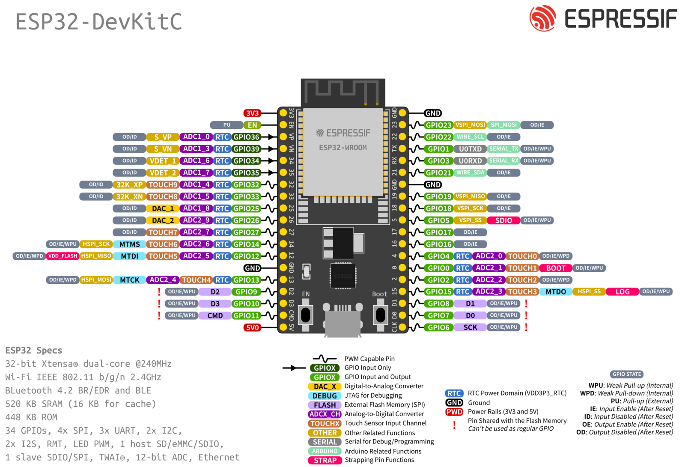

# อุปกรณ์ และ โปรแกรมที่จำเป็นสำหรับการทดลองใช้งาน ESP32

- [อุปกรณ์พื้นฐานที่ต้องใช้](#อุปกรณ์พื้นฐานที่ต้องใช้)
- [โปรแกรมที่ต้องใช้](#โปรแกรมที่ต้องใช้)

## อุปกรณ์พื้นฐานที่ต้องใช้

1.  **โมดูล ESP32** — บอร์ด Micro-Controller รุ่น ESP32-DevKitC V4 ใช้ MCU ESP-32 (ESP32 โมดูลมีให้เลือกใช้จำนวนมาก ขอให้หา Pinout ของรุ่นที่ใช้เอาไว้อ้างอิงเวลาเขียนโปรแกรม)
2.  **โปรโตบอร์ด** — ใช้วางอุปกรณ์และต่อวงจร
3.  **สายปัก** — ใช้เชื่อมต่ออุปกรณ์บนโปรโตบอร์ด มีหลายความยาว ควรมีไว้ให้เพียงพอ
4.  **สาย Micro-USB** — ใช้เชื่อมต่อกับคอมพิวเตอร์ และจ่ายไฟให้กับวงจร

อุปกรณ์ที่จำเป็นอื่น ๆ ขึ้นอยู่กับงานที่ต้องการทดลอง

## โปรแกรมที่ต้องใช้

1.  **Arduino IDE** — แนะนำให้ติดตั้งรุ่น 2.x ล่าสุด \[ [Download](https://docs.arduino.cc/software/ide-v2) \]
2.  **Driver USB to Serial** — โมดูล ESP32 จะมาพร้อมกับ USB to Serial ฝังอยู่ ซึ่งช่วยให้สื่อสารกับคอมพิวเตอร์ได้ ผ่านทางการจำลองเป็น COM port (Virtual Com Port) แต่คอมพิวเตอร์จะต้องติดตั้ง Driver เพื่อให้สามารถใช้งาน USB to Serial นี้ได้ รุ่นของ USB to Serial มีหลากหลาย แต่รุ่นที่นิยมที่สุดรุ่นหนึ่งคือ CP210x\
    \[ [Download Driver CP210x](https://www.silabs.com/developers/usb-to-uart-bridge-vcp-drivers?tab=downloads) \] — ขอให้เลือกใช้ VCP Driver ให้ตรงกับระบบปฏิบัติการที่ใช้
3.  **ESP32 Extension for Arduino IDE** — เพื่อให้เขียนโปรแกรม ESP32 ได้ใน Arduino IDE ขอให้ติดตั้งส่วนเพิ่มขยายสำหรับ ESP32 \[ [ดูคู่มือติดตั้ง](https://randomnerdtutorials.com/installing-esp32-arduino-ide-2-0/) \]
4.  Saleae Logic Analyzer — ใช้จับค่าสัญญาณจากวงจรเพื่อ Debug การทำงาน\
    \[ [Download](https://www.saleae.com/downloads/) \]
5.  **Git-Fork** — ใช้บริหารจัดการ Source Code ด้วย Git ใช้ทั้งสำหรับการดึงตัวอย่างโปรแกรม และการทำโครงงาน \[ [Download](https://git-fork.com/) \]

## สัญญาอนุญาต (License)

ผลงานนี้เผยแพร่ภายใต้สัญญาอนุญาต  
**Creative Commons Attribution–ShareAlike 4.0 International (CC BY-SA 4.0)**  
อนุญาตให้นำไปใช้ แก้ไข และเผยแพร่ต่อได้ โดยต้องระบุที่มา  
และเผยแพร่ภายใต้สัญญาอนุญาตเดียวกัน

โดย  
อ.ดร.อานันท์ สีห์พิทักษ์เกียรติ  
ภาควิชาวิศวกรรมคอมพิวเตอร์ คณะวิศวกรรมศาสตร์  
มหาวิทยาลัยเชียงใหม่
