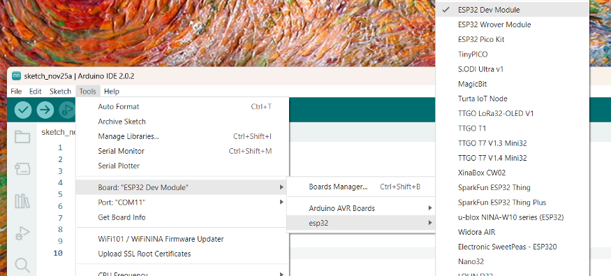
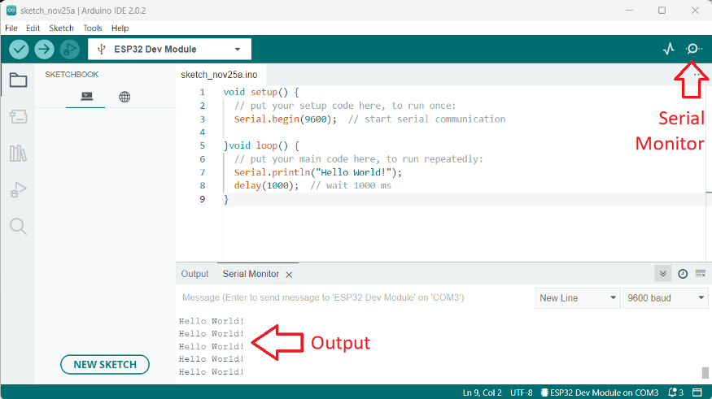
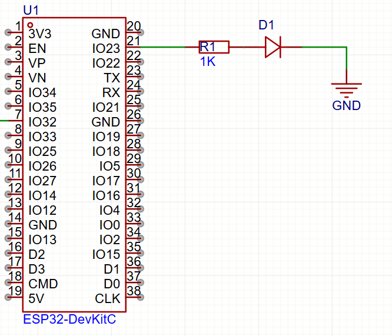
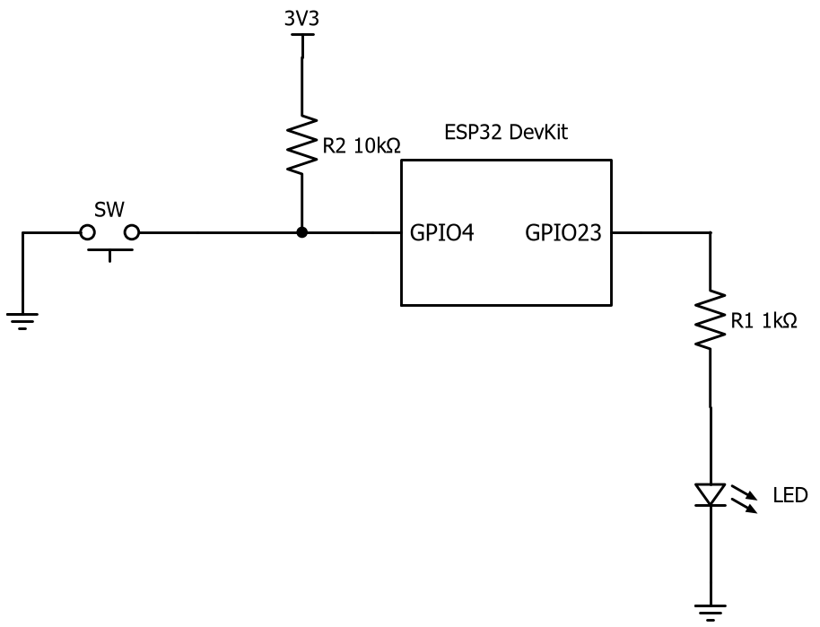
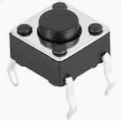
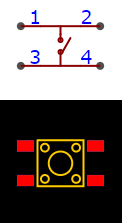
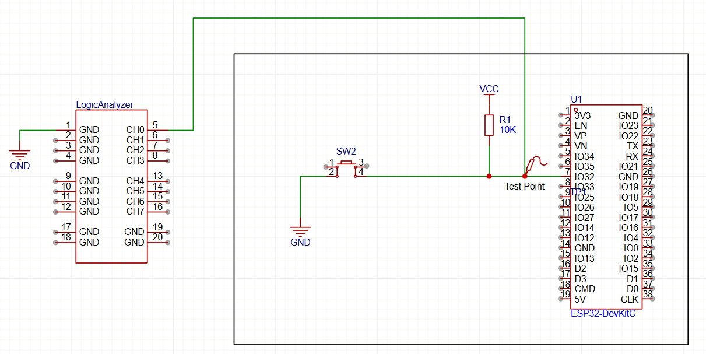
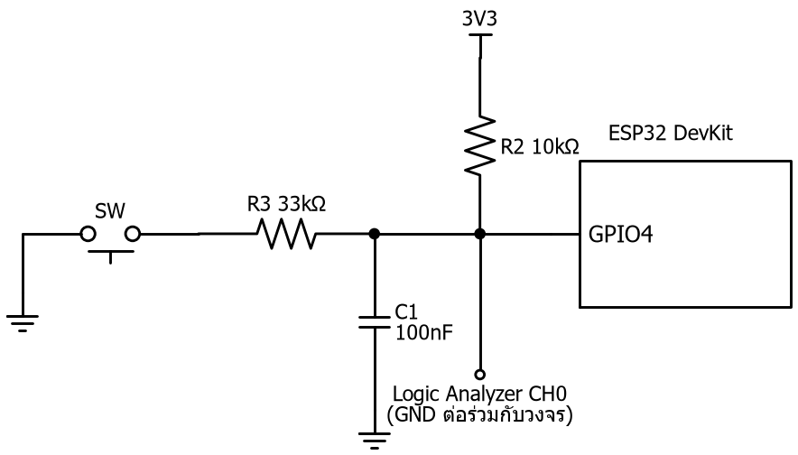

# LAB1 : การต่อวงจร Micro-Controller และการเขียนโปรแกรมควบคุมเบื้องต้น — ด้วย ESP32

- [สิ่งที่ควรจะได้](#สิ่งที่ควรจะได้)
- [ปฏิบัติการ](#ปฏิบัติการ)
- [เครื่องมือที่ต้องใช้](#เครื่องมือที่ต้องใช้)
- [LAB 1.1 — Hello World](#lab-11--hello-world)
  - [ประเมินตนเอง](#ประเมินตนเอง)
- [LAB 1.2 — ไฟกระพริบ](#lab-12--ไฟกระพริบ)
  - [การใช้ชื่อแทนค่าคงที่](#การใช้ชื่อแทนค่าคงที่)
  - [ประเมินตนเอง](#ประเมินตนเอง-1)
- [LAB 1.3 — ควบคุมการทำงานของไฟด้วยปุ่มกด](#lab-13--ควบคุมการทำงานของไฟด้วยปุ่มกด)
  - [1.3.1 ใช้ปุ่มควบคุม LED แบบกดติด ปล่อยดับ](#131-ใช้ปุ่มควบคุม-led-แบบกดติด-ปล่อยดับ)
    - [ทำโปรแกรมต่อให้สมบูรณ์](#ทำโปรแกรมต่อให้สมบูรณ์)
    - [ทำความเข้าใจวงจร Pull-up และ Internal Pull-up](#ทำความเข้าใจวงจร-pull-up-และ-internal-pull-up)
  - [1.3.2 นับจำนวนครั้งที่กดปุ่ม และพิมพ์ค่าออกทาง Serial Port](#132-นับจำนวนครั้งที่กดปุ่ม-และพิมพ์ค่าออกทาง-serial-port)
    - [เงื่อนไข](#เงื่อนไข)
  - [1.3.3 แก้ไขปัญหา Bouncing ของปุ่มกด ด้วย De-Bouncing Filter](#133-แก้ไขปัญหา-bouncing-ของปุ่มกด-ด้วย-de-bouncing-filter)
    - [ใช้ Logic Analyzer ในการจับ Bouncing Signal](#ใช้-logic-analyzer-ในการจับ-bouncing-signal)
    - [แก้ไขสัญญาณ Bounce ด้วย De-bouncing Filter](#แก้ไขสัญญาณ-bounce-ด้วย-de-bouncing-filter)
    - [ประเมินตนเอง](#ประเมินตนเอง-2)


## สิ่งที่ควรจะได้

- เข้าใจหลักการเขียนและโหลดโปรแกรมเข้า Microcontroller
- เขียนโปรแกรมควบคุม I/O เบื้องต้นได้ เช่น LED, ต่อปุ่มกด
- เข้าใจ Pin Mode แบบ Input และ Output
- เข้าใจหลักการ Pull-up, Pull-down และการใช้ Internal Pull-up ของ Microcontroller
- เข้าใจวงจร debounce
- ใช้ Logic Analyzer จับสัญญาณเพื่อพิสูจน์ผลการทำงานของวงจร

## ปฏิบัติการ

- [LAB 1.1 — Hello World](#lab-11--hello-world)
- [LAB 1.2 — ไฟกระพริบ](#lab-12--ไฟกระพริบ)
- [LAB 1.3 — ควบคุมการทำงานของไฟด้วยปุ่มกด](#lab-13--ควบคุมการทำงานของไฟด้วยปุ่มกด)

## เครื่องมือที่ต้องใช้

- ในปฏิบัติการนี้จะใช้โมดูล ESP32 เป็นเครื่องมือ และเขียนโปรแกรมด้วย Arduino IDE
- ขอให้ศึกษา[คู่มือรายการอุปกรณ์และโปรแกรมที่ต้องใช้](1%20MCU%20Setup.md)
- **ขาที่ใช้:** LED ต่อกับ GPIO23 และปุ่มกดต่อกับ GPIO4 เหมือนกันทั้งใน Wokwi และวงจรบน Breadboard ส่วนบอร์ด CM (ESP32-S3) ต่อ LED ไว้ที่ขา IO6 ดูเหตุผลได้ใน[ใบงานบอร์ด CM](1%20MCU%20CM%20board.md)ก่อนทดลองทำหัวข้อต่อไปนี้

## LAB 1.1 — Hello World

ในปฏิบัติการนี้เราจะทดลองเขียนโปรแกรมให้แสดงคำว่า “Hello World” เพื่อให้เห็นกระบวนการพื้นฐานของการ ใช้งานสมองกลฝังตัว

**A. การเตรียม**

- **ต่อสาย USB จากคอมพิวเตอร์ไปยังโมดูล ESP32** — ไฟ Power บนโมดูลควรจะติด แสดงให้เห็นว่าได้รับไฟปกติและพร้อมทำงาน
- **เปิดโปรแกรม Arduino IDE**



- **ตั้งค่าเริ่มต้นสำหรับโมดูล ESP32** — ดังขั้นตอนต่อไปนี้\
  - การตั้งค่าต่อไปนี้จะทำได้ก็ต่อเมื่อติดตั้งส่วนขยายของ ESP32 เรียบร้อยแล้วเท่านั้น\
  - กำหนดรุ่นโมดูลที่ใช้ โดยไปที่เมนู Tools / Board / ESP32\
  - เลือก **ESP32 Dev Module** (อย่าเลือก ESP32S3 หรือตัวอื่นที่ชื่อใกล้เคียง)\
  - กำหนด Port ที่ใช้ โดยไปที่เมนู Tools / Port\
  - เลือก COM Port ที่ต่อกับโมดูล — หมายเลขพอร์ทจะไม่ตายตัว และอาจเปลี่ยนเมื่อย้ายพอร์ท USB อาจต้องลองผิดลองถูกบ้างในกรณีที่มาหลายพอร์ทปรากฏ (ปกติโมดูลจะไม่ใช่ COM 1)

**B. Copy โปรแกรมตัวอย่างต่อไปนี้**

```cpp
void setup() {
  // put your setup code here, to run once:
  Serial.begin(9600);  // start serial communication
  
}

void loop() {
  // put your main code here, to run repeatedly:
  Serial.println("Hello World!");
  delay(1000);  // wait 1000 ms
}
```

ทดลอง Run โปรแกรม และเปิด Serial Monitor ขึ้นมา ซึ่งควรเห็นข้อความ “Hello World” ปรากฏขึ้น



โปรแกรมในระบบ Arduino จะมีฟังก์ชันหลักที่ต้องมีขั้นต่ำ 2 ตัวคือ Setup() ซึ่งจะทำงานครั้งเดียวเมื่อจ่ายไฟให้กับวงจร เหมาะใส่คำสั่งที่ตั้งค่าการทำงาน ส่วน loop() จะทำงานวนซ้ำไปเรื่อย ๆ มีไว้ใส่คำสั่งการทำงานของโปรแกรม

ในตัวอย่างข้างต้น คำสั่ง Serial.begin(9600) เป็นการเปิดใช้ Serial Port บน MCU โดยตั้งค่าความเร็วในการสื่อสารเป็น 9600 bps (bits per seconds) และคำสั่ง serial.println() ทำการพิมพ์ข้อความออกมาทาง Serial Port ซึ่งสามารถสังเกตุค่าได้ผ่านทาง Serial Monitor ของ Arduino IDE

### ประเมินตนเอง

- วงจรทำงานถูกต้องใช่หรือไม่ เห็นคำว่า Hello World ปรากฏใน Serial Monitor ใช่หรือไม่
- เข้าใจโครงสร้างโปรแกรมใช่หรือไม่ หน้าที่ของ setup() และ loop() คืออะไร

## LAB 1.2 — ไฟกระพริบ

ขอให้นักศึกษาต่อวงจรไฟ LED เข้ากับขา GPIO23 ของ ESP32 ตามตัวอย่างต่อไปนี้

ขั้นตอนอย่างย่อ

- ต่อ LED และตัวต้านทาน 100 หรือ 1K Ohm เข้ากับขา GPIO23 ของ ESP32 — ดูขั้วของ LED ให้ถูกต้อง ขายาวคือขาบวก ต่อเข้ากับ GPIO ของ ESP32
- ต่อวงจรลง Ground เพื่อให้สามารถครบวงจร



*ภาพแสดงการต่อวงจร LED*

ใช้โปรแกรมต่อไปนี้ โหลดลงบอร์ด และสังเกตุการทำงาน ไฟ LED ควรติดดับทุก ๆ 1 วินาที (หากต่อ LED เข้ากับขาอื่น ต้องแก้ไขโปรแกรมตามด้วย)

```cpp
void setup() {
  // initialize digital pin LED_BUILTIN as an output.
  pinMode(23, OUTPUT);
}

// the loop function runs over and over again forever
void loop() {
  digitalWrite(23, HIGH);   // turn the LED on 
  delay(1000);             // wait for a second
  digitalWrite(23, LOW);    // turn the LED off 
  delay(1000);             // wait for a second
}
```

ในโปรแกรมข้างต้น การเปิดปิด LED ประกอบไปด้วยสองส่วนหลัก ๆ ด้วยกันคือ

- pinMode() — ทำการกำหนดว่า Pin ที่ต่อกับ LED ทำหน้าที่เป็น Input หรือ Output ซึ่งในที่นี้ต้องตั้งค่าให้เป็น Output
- digitalWrite() — กำหนดสถานะ Hight/Low ให้กับ Pin ที่ต้องการ

### การใช้ชื่อแทนค่าคงที่

ลองใช้ คำสั่ง \#define เพื่อให้โปรแกรมอ่านได้ง่ายขึ้น คือ ใช้คำว่า LED แทนตัวเลข 23 และคำว่า DELAY_TIME แทนค่าคงที่ในโปรแกรม — นี่เป็นวินัยที่ดีโดยเฉพาะเมื่อโปรแกรมมีความซับซ้อนมากขึ้น

```cpp
#define LED  23
#define DELAY_TIME  1000

void setup() {
  // initialize digital pin LED_BUILTIN as an output.
  pinMode(LED, OUTPUT);
}

// the loop function runs over and over again forever
void loop() {
  digitalWrite(LED, HIGH);   // turn the LED on 
  delay(DELAY_TIME);             // wait for a second
  digitalWrite(LED, LOW);    // turn the LED off 
  delay(DELAY_TIME);             // wait for a second
}
```

### ประเมินตนเอง

- เข้าใจวงจรที่ต่อใช่หรือไม่ ดูออกหรือไม่ว่าขาใดของ LED เป็นบวก ขาดใดเป็นลบ, ตัวต้านทานมีบทบาทอย่างไร ไม่มีได้หรือไม่ การเพิ่มหรือลดค่ามีผลต่อความสว่างของ LED อย่างไร
- ถ้าสมมุติว่าให้ต่อ LED ตัวที่สองเข้ากับ Pin 3 โดยสถานะติด-ดับตรงกันข้ามกับ LED แรก และไม่มีการแก้โปรแกรมใด ๆ สามารถทำได้หรือไม่
- เข้าใจการทำงานของโปรแกรม โดยเฉพาะคำสั่ง pinMode(), digitalWrite() ใช่หรือไม่

## LAB 1.3 — ควบคุมการทำงานของไฟด้วยปุ่มกด

ให้ทดลองต่อวงจรและเขียนโปรแกรมตามที่กำหนดดังต่อไปนี้

### 1.3.1 ใช้ปุ่มควบคุม LED แบบกดติด ปล่อยดับ

ให้เพิ่มปุ่มกด (push button) เข้าไปในวงจร โดยต่อเข้ากับ Pin GPIO4 (ถ้าอยากใช้ GPIO อื่นต้องตรวจ Datasheet GPIO นั้น ๆ ใช้งานได้ตามที่ต้องการหรือไม่) โดยขา Input นี้จะใช้วงจรแบบ “Pull-up” กับตัวต้านทานขนาด 10K Ohms



*ภาพแสดงวงจรทั้งฝั่ง Input ปุ่มกด (ฝั่งซ้ายต่อกับขา IO4) และฝั่ง Output LED (ฝั่งขวาต่อกับ IO23)*

สังเกตุว่าปุ่มกดเป็นอุปกรณ์ 4 ขา ซึ่งมีการเชื่อมต่อภายในดังนี้





*กายภาพของปุ่มแบบ 4 ขา*

โปรแกรมที่ต้องเขียนจะมีการเพิ่มคำสั่งอ่านสถานะของ pin ดังตัวอย่าง

```cpp
#define LED     23
#define BUTTON  4

void setup() {
  pinMode(BUTTON, INPUT); // set arduino pin to input mode
  pinMode(LED, OUTPUT);  // set arduino pin to output mode
}

void loop() {
  if(digitalRead(BUTTON)==LOW) { 
    digitalWrite(LED, HIGH);
  }
}
```

โปรแกรมข้างต้นจะเปิด LED เมื่อมีการกดปุ่ม โดยมีการทำงานดังนี้

- pinMode(BUTTON, INPUT) ทำการตั้งค่า pin 4 ให้เป็น input
- digitalRead() อ่านสถานะของ pin ค่าที่ได้คือ HIGH หรือ LOW

#### ทำโปรแกรมต่อให้สมบูรณ์

ขอให้เขียนโปรแกรมเพิ่มเติมเพื่อให้ไฟติดและดับตามสถานะการกดปุ่ม (กดติดปล่อยดับ)

#### ทำความเข้าใจวงจร Pull-up และ Internal Pull-up

**Pull-up Resistor** — เป็นวงจรที่ทำให้สถานะของ pin 4 เป็น high เวลาที่ปุ่มไม่ถูกกด หากไม่มีตัวต้านทานนี้ จะทำให้สถานะของ pin 4 แกว่งระหว่าง high-low ได้ และทำให้เกิดพฤติกรรมที่ไม่พึงประสงค์ขึ้นได้** Internal Pull-up** — ESP32 มี internal pull-up resistor มาให้กับ GPIO บางขา (ดู Datasheet ประกอบ) ซึ่งช่วยให้กำจัดตัวต้านทาน pull-up ที่ใช้อยู่ได้ ซึ่งขา GPIO 4 ที่ใช้ข้างต้นสนับสนุนความสามารถนี้ โดยจะต้องเปลี่ยนการประกาศ pinMode ให้เป็นดังนี้

```cpp
pinMode(BUTTON, INPUT_PULLUP);
```

ข้อดีของการใช้ Internal Pull-up คือ**ลดชิ้นส่วน**ในวงจร (ตัวต้านทาน) แต่ MCU บางตัวอาจไม่มีความสามารถนี้ หรือมีให้เพียงบางขาเท่านั้น จึงต้องระวังเมื่อใช้งาน

### 1.3.2 นับจำนวนครั้งที่กดปุ่ม และพิมพ์ค่าออกทาง Serial Port

ให้ต่อยอดโปรแกรมเดิมเพื่อให้ทุกครั้งที่กดปุ่มโปรแกรมจะเพิ่มการนับขึ้น 1 และพิมพ์ค่านั้นออกมาผ่าน Serial Port

#### เงื่อนไข

แบบฝึกหัดนี้แม้ไม่ต้องใช้คำสั่งใหม่ แต่ให้ระวังการนับและพิมพ์ค่ารัวเมื่อกดปุ่มค้าง การแก้ไขปัญหานี้จะต้องเขียนโปรแกรมเพื่อให้นับค่าแค่ครั้งเดียวต่อการกดหนึ่งครั้ง เช่น หลังจากที่พบว่ามีการกดปุ่ม ก็เขียนโปรแกรมให้รอจนกว่าจะปล่อยปุ่มถึงจะทำงานต่อ เป็นต้น

### 1.3.3 แก้ไขปัญหา Bouncing ของปุ่มกด ด้วย De-Bouncing Filter

ปัญหาหนึ่งที่มักพบในการอ่านค่าจะอุปกรณ์เช่นปุ่มกด คือค่าที่ได้ในชั่วขณะที่กด หรือปล่อย จะมี Noise หรือที่เรียกว่าการ bounce ของค่า สถานะของปุ่มเปลี่ยนไปมาระหว่าง High กับ Low ซึ่งส่งผลต่อการทำงานของโปรแกรม เพราะจะทำให้โปรแกรมนึกว่ามีการกด-ปล่อยรัว ๆ หลายครั้ง

#### ใช้ Logic Analyzer ในการจับ Bouncing Signal

ขอให้ใช้ Logic Analyzer วัดค่าสถานะของขา BUTTON เพื่อให้เห็นว่าสัญญาณ Bounce นั้นเป็นอย่างไร



*แสดงการต่อ Logic Analyzer เพื่อจับสัญญาณจากปุ่มที่เข้า MCU*

แสดงการต่อ Logic Analyzer เพื่อจับสัญญาณจากปุ่มเข้า ESP32

[](https://www.youtube.com/watch?v=SLzTTlzXS5o)

#### แก้ไขสัญญาณ Bounce ด้วย De-bouncing Filter

ให้ต่อ Resistor ขนาด 33K และ Capacitor ขนาด 0.1 uF ดังแสดงในภาพ เพื่อทำหน้าที่ดูซับ Noise ที่เกิดขึ้น โดยเมื่อต่อแล้วให้ลองวัดสัญญาณอีกครั้งว่า Bouncing หายไปหรือไม่



*แสดงการเพิ่ม Debounce circuit เป็นวงจร Low-pass filter เพื่อกำจัด Noise ของปุ่ม ค่าของ R, C ที่ใช้มีผลต่อการทำงานของ Filter นี้*

#### ประเมินตนเอง

- โปรแกรมทำงานถูกต้องหรือไม่\
  - ค่าที่นับต้องไม่นับรัวเวลากดปุ่มค้าง\
  - นับค่าเฉพาะเมื่อกดปุ่ม ห้ามนับเมื่อคลายปุ่ม
- เข้าใจหลักการ Pull-up/Pull-down หรือไม่ หากขอให้เปลี่ยนวงจรปุ่มเป็นแบบ Pull-down จะต้องแก้วงจรและโปรแกรมอย่างไร
- สามารถใช้ Logic Analyzer วิเคราะห์ปัญหาในวงจรได้หรือไม่
- เข้าใจหรือไม่ว่า Bouncing Signal (noise) คืออะไร และสร้างปัญหาอย่างไร
- เข้าใจหรือไม่ว่า De-bouncing Filter แก้ไขปัญหาอย่างไร

## สัญญาอนุญาต (License)


ผลงานนี้เผยแพร่ภายใต้สัญญาอนุญาต  
**Creative Commons Attribution–ShareAlike 4.0 International (CC BY-SA 4.0)**  
อนุญาตให้นำไปใช้ แก้ไข และเผยแพร่ต่อได้ โดยต้องระบุที่มา  
และเผยแพร่ภายใต้สัญญาอนุญาตเดียวกัน

โดย  
อ.ดร.อานันท์ สีห์พิทักษ์เกียรติ  
ภาควิชาวิศวกรรมคอมพิวเตอร์ คณะวิศวกรรมศาสตร์  
มหาวิทยาลัยเชียงใหม่

---

*เอกสารนี้ใช้ Opus 5.5 ในการสร้างเนื้อหาบางส่วน และตรวจสอบความถูกต้อง และความสอดคล้องระหว่าง Lab 1 ทั้ง 3 กิจกรรม ภายใต้การกำกับดูแลโดยผู้สอน*
