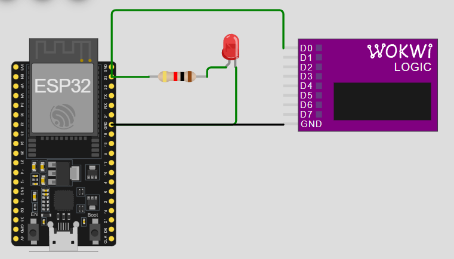
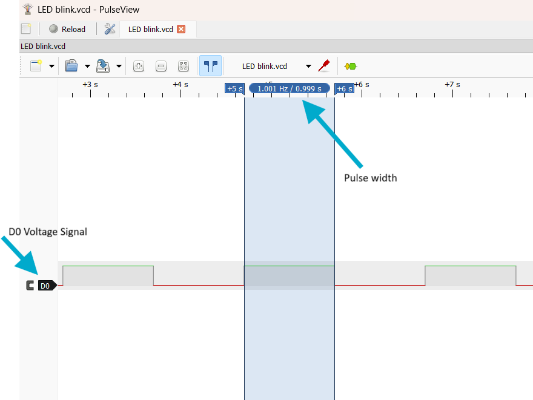
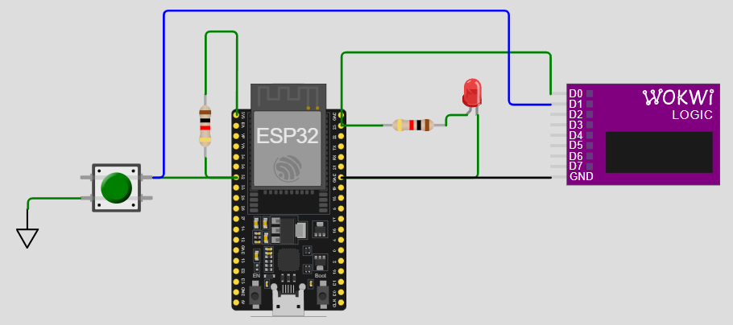
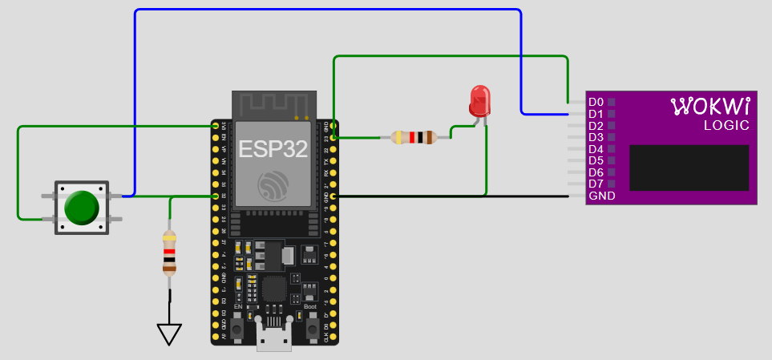

# LAB 1A — การทดลองบน Wokwi (ESP32)

- [เป้าหมายของการทดลองบน Wokwi](#เป้าหมายของการทดลองบน-wokwi)
- [1.1 Hello World (Serial Monitor)](#11-hello-world-serial-monitor)
  - [ขั้นตอน](#ขั้นตอน)
  - [สิ่งที่ต้องส่ง](#สิ่งที่ต้องส่ง)
- [1.2 ไฟกะพริบ (Blink LED)](#12-ไฟกะพริบ-blink-led)
  - [ขั้นตอน](#ขั้นตอน-1)
  - [สิ่งที่ต้องส่ง](#สิ่งที่ต้องส่ง-1)
- [1.3 ปุ่มกดและการอ่านสัญญาณ](#13-ปุ่มกดและการอ่านสัญญาณ)
  - [1.3.1 กดติด ปล่อยดับ และวงจร Pull-up / Pull-down](#131-กดติด-ปล่อยดับ-และวงจร-pull-up--pull-down)
    - [ขั้นตอน](#ขั้นตอน-2)
    - [เปลี่ยนวงจรปุ่มเป็น Pull-down](#เปลี่ยนวงจรปุ่มเป็น-pull-down)
    - [สิ่งที่ต้องส่ง](#สิ่งที่ต้องส่ง-2)
  - [1.3.2 นับจำนวนครั้งที่กดปุ่ม](#132-นับจำนวนครั้งที่กดปุ่ม)
    - [เป้าหมาย](#เป้าหมาย)
    - [ขั้นตอน](#ขั้นตอน-3)
    - [สิ่งที่ต้องส่ง](#สิ่งที่ต้องส่ง-3)
  - [1.3.3 ดูสัญญาณ Bounce ด้วย Logic Analyzer](#133-ดูสัญญาณ-bounce-ด้วย-logic-analyzer)
    - [ขั้นตอน](#ขั้นตอน-4)
    - [สิ่งที่ต้องส่ง](#สิ่งที่ต้องส่ง-4)
- [รายการส่งทั้งหมด](#รายการส่งทั้งหมด)

ใบงานนี้เริ่มจากการจำลองวงจรบน Wokwi ให้ลองเขียนโปรแกรมควบคุม LED และอ่านค่าจากปุ่มกด จากนั้นใช้ Logic Analyzer ดูว่าสัญญาณเปลี่ยนไปอย่างไรตอนกดและปล่อยปุ่ม

Lab 1 มีสามใบงาน ให้เริ่มจาก LAB 1A บน Wokwi (ใบงานนี้) แล้วทำ [LAB 1B บนบอร์ด GoGo CM](1B%20MCU%20GoGo%20CM%20board.md) และ [LAB 1C บนเบรดบอร์ด](1C%20MCU%20breadboard%20circuit.md) ตามลำดับ เลขข้อเดียวกันหมายถึงกิจกรรมเดียวกัน เช่น ข้อ 1.3.2 เป็นการนับจำนวนครั้งที่กดปุ่มในทั้งสามใบงาน

เปิด [Wokwi](https://wokwi.com) แล้วเลือกโปรเจกต์สำหรับ **ESP32** รุ่นเดียวกับบอร์ดในชุด Lab ใบงานนี้ใช้ GPIO23 สำหรับ LED และ GPIO4 สำหรับปุ่มกด เหมือนกับวงจรบนเบรดบอร์ด ส่วนบอร์ด GoGo CM ใช้ IO6 สำหรับ LED ดูเหตุผลได้ใน[ใบงาน LAB 1B](1B%20MCU%20GoGo%20CM%20board.md)

---

## เป้าหมายของการทดลองบน Wokwi

เมื่อทำครบทุกกิจกรรมแล้ว นักศึกษาควรทำสิ่งต่อไปนี้ได้

- สร้างวงจรจำลองบน Wokwi แล้วเขียนโปรแกรมควบคุม LED และอ่านค่าจากปุ่มกด
- อธิบายได้ว่า Pull-up, Internal Pull-up และ Pull-down ทำให้ค่าที่อ่านจากปุ่มต่างกันอย่างไร
- ใช้ Logic Analyzer บันทึกสัญญาณ แล้วเปิดไฟล์ VCD ใน PulseView เพื่อวัดช่วงเวลาและสังเกต Bounce

---

## 1.1 Hello World (Serial Monitor)

### ขั้นตอน

1. สร้างโปรเจกต์ ESP32 ใน Wokwi แล้วใส่โค้ดด้านล่างในไฟล์ `sketch.ino`

```cpp
void setup() {
  Serial.begin(9600);
}

void loop() {
  Serial.println("Hello World!");
  delay(1000);
}
```

2. กดปุ่มเริ่มการจำลอง แล้วดูข้อความใน Serial Monitor ควรเห็น “Hello World!” ขึ้นบรรทัดใหม่ทุกวินาที

### สิ่งที่ต้องส่ง

- ส่งภาพหน้าจอ Serial Monitor ที่เห็นข้อความ “Hello World!” หลายบรรทัด

---

## 1.2 ไฟกะพริบ (Blink LED)

### ขั้นตอน

1. กดปุ่มบวกเพื่อเพิ่ม LED และตัวต้านทาน เลือกสี LED ตามต้องการ และใช้ตัวต้านทานขนาด 500 Ω ถึง 1 kΩ
2. ต่อ LED กับ GPIO23 และ GND โดยมีตัวต้านทานต่ออนุกรมกับ LED
3. ใส่โค้ดด้านล่างแล้วเริ่มการจำลอง สังเกตว่า LED ติดและดับสลับกันอย่างไร

```cpp
#define LED 23
#define DELAY_TIME 1000

void setup() {
  pinMode(LED, OUTPUT);
}

void loop() {
  digitalWrite(LED, HIGH);
  delay(DELAY_TIME);
  digitalWrite(LED, LOW);
  delay(DELAY_TIME);
}
```

4. เพิ่ม Logic Analyzer ตามภาพ ต่อช่อง D0 เข้ากับ GPIO23 แล้วต่อขา GND ของเครื่องมือเข้ากับกราวด์ของวงจร

   

5. เริ่มการจำลองอีกครั้งแล้วปล่อยให้ LED กะพริบสักสองสามรอบ เมื่อหยุดการจำลอง Wokwi จะดาวน์โหลดไฟล์ `wokwi-logic.vcd` ให้
6. เปิดไฟล์ VCD (Value Change Dump) ใน PulseView ตาม[คู่มือของ Wokwi](https://docs.wokwi.com/guides/logic-analyzer#viewing-the-data-in-pulseview) แล้ววัดว่าช่อง D0 เป็น `HIGH` นานเท่าไร ค่าที่วัดได้ควรใกล้เคียง 1,000 ms

### สิ่งที่ต้องส่ง

- ส่งภาพวงจรบน Wokwi และภาพจาก PulseView ที่เห็นช่วง `HIGH` พร้อมความกว้างพัลส์ที่วัดได้

ตัวอย่างการวัดใน PulseView



---

## 1.3 ปุ่มกดและการอ่านสัญญาณ

### 1.3.1 กดติด ปล่อยดับ และวงจร Pull-up / Pull-down

#### ขั้นตอน

1. เพิ่มปุ่มกด (Pushbutton) ให้หน้าสัมผัสด้านหนึ่งต่อกับ GPIO4 และอีกด้านต่อกับ GND จากนั้นต่อตัวต้านทาน Pull-up ระหว่าง GPIO4 กับ 3.3 V
2. ต่อช่อง D1 ของ Logic Analyzer เข้ากับ GPIO4 โดยให้ช่อง D0 ยังต่อกับ GPIO23 เหมือนเดิม

   

   *ภาพตัวอย่างใช้ GPIO32 สำหรับปุ่มกด ในใบงานนี้ให้ต่อปุ่มและช่อง D1 ที่ GPIO4*

3. ใส่โค้ดด้านล่างแล้วลองกดและปล่อยปุ่ม สังเกตว่า LED ติดหรือดับในแต่ละจังหวะ

```cpp
#define LED 23
#define BUTTON 4

void setup() {
  pinMode(LED, OUTPUT);
  pinMode(BUTTON, INPUT);
}

void loop() {
  if (digitalRead(BUTTON) == LOW) {
    digitalWrite(LED, HIGH);
  } else {
    digitalWrite(LED, LOW);
  }
}
```

4. เปิดไฟล์ VCD ใน PulseView แล้วเทียบช่อง D0 กับ D1 ตัวต้านทาน Pull-up ดึง GPIO4 ไว้ที่ `HIGH` ตอนปล่อยปุ่ม เมื่อกดปุ่ม GPIO4 จะต่อลง GND และอ่านได้ `LOW` ลองดูว่าสถานะของ LED เปลี่ยนตามสัญญาณปุ่มอย่างไร
5. ลองใช้ตัวต้านทาน Pull-up ภายใน ESP32 (Internal Pull-up) โดยเปลี่ยนบรรทัดตั้งค่าขาปุ่มใน `setup()` เป็นคำสั่งด้านล่าง แล้วถอดตัวต้านทาน Pull-up ภายนอกออก ทดลองอีกครั้งว่าปุ่มยังควบคุม LED ได้เหมือนเดิมหรือไม่

```cpp
pinMode(BUTTON, INPUT_PULLUP);
```

#### เปลี่ยนวงจรปุ่มเป็น Pull-down



*ภาพตัวอย่างใช้ GPIO32 สำหรับปุ่มกด ในใบงานนี้ให้ต่อปุ่มที่ GPIO4*

1. ย้ายตัวต้านทานจากฝั่ง 3.3 V ไปต่อระหว่าง GPIO4 กับ GND แล้วต่อปุ่มให้ GPIO4 เชื่อมกับ 3.3 V เมื่อกด
2. เปลี่ยนการตั้งค่าขาปุ่มกลับเป็น `pinMode(BUTTON, INPUT);` เพื่อปิด Internal Pull-up
3. ลองใช้เงื่อนไขเดิมใน `loop()` แล้วสังเกตว่า LED ดับตอนกดและติดตอนปล่อย จากนั้นแก้เงื่อนไขให้กลับมากดติด ปล่อยดับ
4. เปิดไฟล์ VCD ใน PulseView แล้วเทียบสัญญาณปุ่มกับสัญญาณ LED อีกครั้ง

#### สิ่งที่ต้องส่ง

- ส่งภาพวงจรแบบ Pull-up และ Pull-down พร้อมภาพจาก PulseView ที่เห็นสัญญาณที่ขาปุ่มและขา LED ของทั้งสองแบบ

---

### 1.3.2 นับจำนวนครั้งที่กดปุ่ม

#### เป้าหมาย

เขียนโปรแกรมให้นับหนึ่งครั้งต่อการกดหนึ่งครั้ง แม้จะกดปุ่มค้างไว้

#### ขั้นตอน

1. เปลี่ยนวงจรกลับเป็นแบบ Pull-up และปิดการจำลอง Bounce ไว้ก่อน โดยตั้งแอตทริบิวต์ `bounce` ของปุ่มเป็น `"0"` ในไฟล์ `diagram.json` ข้อนี้จะได้ทดสอบการนับตอนกดค้างก่อน แล้วค่อยเปิด Bounce ในข้อถัดไป
2. เก็บสถานะปุ่มจากรอบก่อน แล้วเพิ่มค่าตัวนับทีละ 1 เมื่อสัญญาณเปลี่ยนจาก `HIGH` เป็น `LOW` ให้แสดงค่าตัวนับใน Serial Monitor
3. ให้ LED กะพริบตามค่าที่นับได้ เช่น กดครั้งแรกให้กะพริบหนึ่งครั้ง กดครั้งที่ห้าให้กะพริบห้าครั้ง
4. ลองกดค้างแล้วปล่อย ค่าตัวนับควรเพิ่มครั้งเดียวตอนกด และคงเดิมเมื่อปล่อยปุ่ม

#### สิ่งที่ต้องส่ง

- ส่งภาพจาก PulseView ที่เห็นสัญญาณปุ่มและจังหวะกะพริบของ LED เพื่อแสดงว่าโปรแกรมทำงานตามที่กำหนด

---

### 1.3.3 ดูสัญญาณ Bounce ด้วย Logic Analyzer

เวลากดหรือปล่อยปุ่มจริง หน้าสัมผัสอาจแตะแล้วแยกออกจากกันหลายครั้งก่อนจะนิ่ง ช่วงสั้น ๆ นี้เรียกว่า Bounce ถ้าโปรแกรมนับทุกครั้งที่สัญญาณเปลี่ยนจาก `HIGH` เป็น `LOW` ก็อาจนับการกดครั้งเดียวเป็นหลายครั้งได้ ปุ่มใน Wokwi [จำลอง Bounce ไว้โดยค่าเริ่มต้น](https://docs.wokwi.com/parts/wokwi-pushbutton#bouncing)

#### ขั้นตอน

1. ใช้วงจรเดิม แล้วลบแอตทริบิวต์ `"bounce": "0"` ของปุ่มออกจาก `diagram.json` เพื่อกลับไปใช้ค่าเริ่มต้น
2. เริ่มการจำลอง ลองกดและปล่อยปุ่ม จากนั้นหยุดการจำลองแล้วเปิดไฟล์ VCD ใน PulseView
3. ขยายภาพสัญญาณช่อง D1 ตรงจังหวะกดและปล่อย ดูว่าระดับสัญญาณสลับไปมากี่ครั้งก่อนจะนิ่ง

#### สิ่งที่ต้องส่ง

- ส่งภาพจาก PulseView ที่เห็น Bounce พร้อมอธิบายว่าสัญญาณที่เห็นอาจทำให้โปรแกรมนับผิดได้อย่างไร

---

## รายการส่งทั้งหมด

1. **ข้อ 1.1** ภาพหน้าจอ Serial Monitor ที่แสดงข้อความ “Hello World!”
2. **ข้อ 1.2** ภาพวงจรบน Wokwi และภาพจาก PulseView ที่แสดงความกว้างพัลส์ช่วง `HIGH` (ประมาณ 1,000 ms)
3. **ข้อ 1.3.1** ภาพวงจรและภาพสัญญาณจาก PulseView ทั้งแบบ Pull-up และ Pull-down
4. **ข้อ 1.3.2** ภาพจาก PulseView ที่แสดงการทำงานของปุ่มและ LED
5. **ข้อ 1.3.3** ภาพ Bounce จาก PulseView พร้อมคำอธิบายว่ามีผลต่อการนับอย่างไร

## สัญญาอนุญาต (License)


ผลงานนี้เผยแพร่ภายใต้สัญญาอนุญาต  
**Creative Commons Attribution–ShareAlike 4.0 International (CC BY-SA 4.0)**  
อนุญาตให้นำไปใช้ แก้ไข และเผยแพร่ต่อได้ โดยต้องระบุที่มา  
และเผยแพร่ภายใต้สัญญาอนุญาตเดียวกัน

โดย  
อ.ดร.อานันท์ สีห์พิทักษ์เกียรติ  
ภาควิชาวิศวกรรมคอมพิวเตอร์ คณะวิศวกรรมศาสตร์  
มหาวิทยาลัยเชียงใหม่

---

*เอกสารนี้ใช้ Opus 5.5 ในการสร้างเนื้อหาบางส่วน และตรวจสอบความถูกต้อง และความสอดคล้องระหว่าง Lab 1 ทั้ง 3 กิจกรรม ภายใต้การกำกับดูแลโดยผู้สอน*
