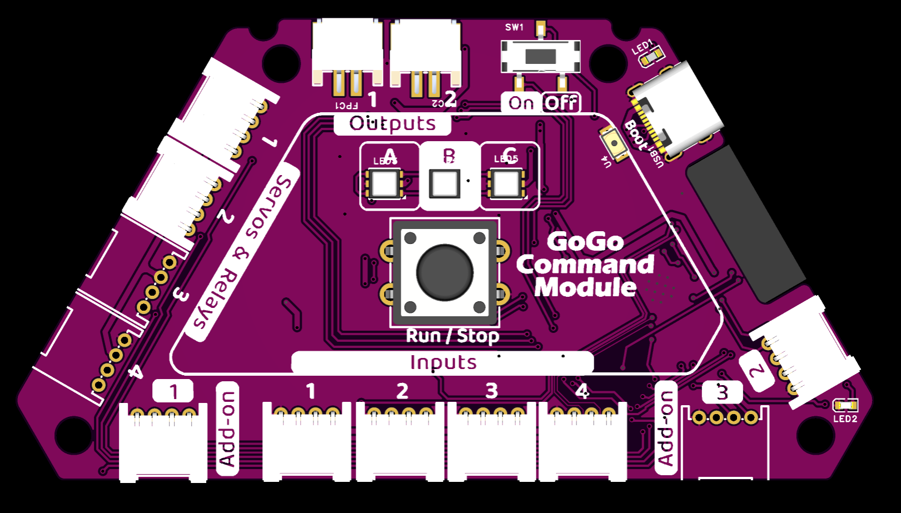
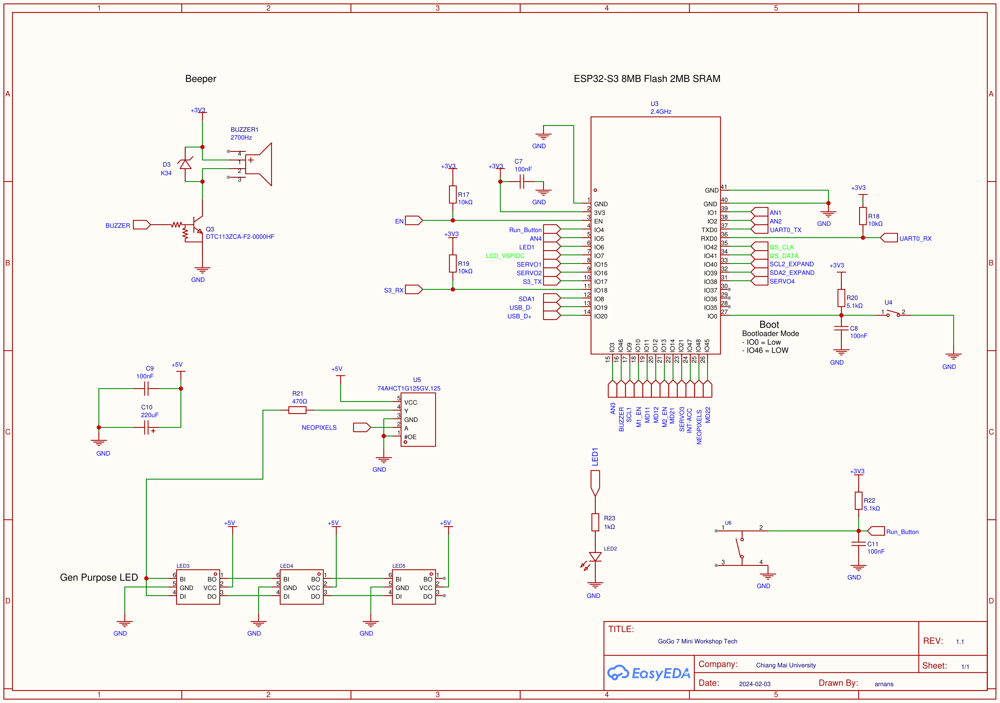

# LAB 1B — ไมโครคอนโทรลเลอร์เบื้องต้นบนบอร์ด GoGo CM

หลังจากทำ [LAB 1A บน Wokwi](1A%20MCU%20wokwi.md) ให้ลองส่งข้อความไปยัง Serial Monitor ควบคุม LED และอ่านค่าปุ่มกดบนบอร์ด GoGo Command Module (GoGo CM) บอร์ดนี้ใช้ชิป **ESP32-S3** และมี LED กับปุ่มกดอยู่แล้ว เราจะใช้แผนผังวงจรดูว่าอุปกรณ์เหล่านี้ต่อกับขาใด



*LED2 สีแดงอยู่มุมขวาล่าง (IO6) ปุ่ม Run / Stop อยู่กลางบอร์ด (IO4) ปุ่ม Boot (U4) อยู่ข้างช่อง USB-C และสวิตช์เปิด–ปิด (SW1) อยู่ด้านบน*

- [การเตรียมบอร์ด GoGo CM](#การเตรียมบอร์ด-gogo-cm)
- [1.1 Hello World](#11-hello-world)
- [1.2 ไฟกะพริบ](#12-ไฟกะพริบ)
- [1.3 ควบคุม LED ด้วยปุ่มกด](#13-ควบคุม-led-ด้วยปุ่มกด)
- [สิ่งที่ต้องส่ง](#สิ่งที่ต้องส่ง)

## การเตรียมบอร์ด GoGo CM

1. ต่อบอร์ดเข้ากับคอมพิวเตอร์ด้วยสาย USB-C แล้วเลื่อนสวิตช์ SW1 ไปที่ **On**
2. เปิด Arduino IDE ถ้ายังไม่ได้ติดตั้งส่วนรองรับบอร์ด ESP32 ให้ทำตาม[คู่มือการเตรียมอุปกรณ์และโปรแกรม](1%20MCU%20Setup.md) โดยข้ามขั้นตอนติดตั้งไดรเวอร์ CP210x
3. ไปที่ **Tools → Board → esp32** แล้วเลือก **ESP32S3 Dev Module**
4. ไปที่ **Tools → USB CDC On Boot** แล้วเลือก **Enabled** เมื่อเปลี่ยนบอร์ด ให้ตรวจค่านี้อีกครั้ง
5. ไปที่ **Tools → Port** แล้วเลือกพอร์ตของ GoGo CM ตัวเลือกอื่นในเมนู **Tools** ใช้ค่าเริ่มต้นได้

## 1.1 Hello World

อัปโหลดโปรแกรมด้านล่าง แล้วเปิด Serial Monitor ควรเห็นข้อความ `Hello World!` ขึ้นบรรทัดใหม่ทุกวินาที

```cpp
void setup() {
  Serial.begin();
}

void loop() {
  Serial.println("Hello World!");
  delay(1000);
}
```

เมื่อเปิด **USB CDC On Boot** คำสั่ง `Serial` จะส่งข้อมูลผ่าน USB ของ ESP32-S3 โดยตรง จึงเรียก `Serial.begin()` ได้โดยไม่ต้องใส่ค่า baud rate ส่วนบอร์ด ESP32 ในชุด Lab ใช้ `Serial` ส่งข้อมูลผ่าน UART0 แล้วใช้ชิป CP210x แปลงสัญญาณเป็น USB

**ลองเปรียบเทียบ** เปลี่ยนค่า baud rate ใน Serial Monitor แล้วจดว่าข้อความที่แสดงเปลี่ยนไปไหม เมื่อทำ [LAB 1C](1C%20MCU%20breadboard%20circuit.md#11-hello-world) ให้ลองแบบเดียวกันกับบอร์ด ESP32 ที่ใช้ `Serial.begin(9600)` แล้วอธิบายว่าทั้งสองบอร์ดให้ผลต่างกันอย่างไร

### ถ้าอัปโหลดไม่ได้หรือไม่เห็นข้อความ

- **คอมไพล์ไม่ผ่าน** ถ้าขึ้น `no matching function for call to 'HardwareSerial::begin()'` ให้ตรวจว่าเลือก **ESP32S3 Dev Module** และตั้ง **USB CDC On Boot** เป็น **Enabled**
- **ไม่เห็นพอร์ตหรืออัปโหลดไม่สำเร็จ** กดปุ่ม **Boot** ค้างไว้ ใช้ SW1 ปิดแล้วเปิดบอร์ด จากนั้นปล่อยปุ่ม Boot เลือกพอร์ต แล้วลองอัปโหลดอีกครั้ง เมื่ออัปโหลดเสร็จให้ปิดแล้วเปิดบอร์ดอีกครั้ง
- **อัปโหลดแล้วแต่โปรแกรมยังไม่ทำงาน** ใช้ SW1 ปิดแล้วเปิดบอร์ด รอให้พอร์ตกลับมา ตรวจพอร์ตใน **Tools → Port** แล้วเปิด Serial Monitor อีกครั้ง

## 1.2 ไฟกะพริบ

### แผนผังวงจรของบอร์ด GoGo CM

เปิด[แผนผังวงจร (PDF)](schematics/GoGo%20CM%20schematic.pdf) แล้วดูหน้า 1 ตามลำดับหน้าในไฟล์ กรอบชื่อมุมขวาล่างใช้ชื่อ **GoGo 7 Mini Workshop Tech** และแสดง `Sheet 1/1` ทุกหน้า

- ใช้ตัวอักษรและตัวเลขที่ขอบกระดาษบอกตำแหน่ง เช่น **D4** คือแถว D คอลัมน์ 4
- จุดที่มีป้ายชื่อสัญญาณ (net label) เดียวกันต่อถึงกัน แม้อยู่คนละหน้า เช่น ป้าย `LED1` หน้า 1 เชื่อมขา IO6 กับวงจร LED2 ส่วนอุปกรณ์ `LED1` หน้า 2 คือไฟแสดงสถานะไฟเลี้ยง



1. หาขา **IO6** ของชิป **U3** ในช่อง **B4** ขานี้ต่อกับป้าย `LED1`
2. หาป้าย `LED1` อีกจุดในช่อง **C4** แล้วไล่เส้นลงมาที่ **D4** จะพบ **R23 (1 kΩ)** ต่ออนุกรมกับ **LED2** ลงกราวด์ (GND)
3. ดูทิศของสัญลักษณ์ LED2 แล้วตอบว่า LED2 จะติดเมื่อ IO6 เป็น `HIGH` หรือ `LOW` จากนั้นอัปโหลดโค้ด แล้วดูว่า LED สลับติดและดับทุกวินาทีหรือไม่

```cpp
#define LED         6
#define DELAY_TIME  1000

void setup() {
  pinMode(LED, OUTPUT);
}

void loop() {
  digitalWrite(LED, HIGH);
  delay(DELAY_TIME);
  digitalWrite(LED, LOW);
  delay(DELAY_TIME);
}
```

**คำถามชวนคิด**

- ในบอร์ด ESP32 ชุด Lab ขา GPIO6 ต่อกับหน่วยความจำ Flash ที่เก็บโปรแกรม จึงใช้ GPIO23 ควบคุม LED ใน LAB 1C ถ้านำโค้ดนี้ไปใช้กับบอร์ดในชุด Lab โดยยังใช้ขา 6 จะกระทบการอ่านโปรแกรมอย่างไร ให้ตอบจากข้อมูลนี้โดยไม่ต้องลองกับบอร์ดจริง
- ถ้าบอร์ดไม่มีจุดต่อสายวัดที่ IO6 จะใช้ Logic Analyzer ดูจังหวะที่โปรแกรมสั่งให้ LED ติดและดับได้อย่างไร

**ลองดูสัญญาณด้วย Logic Analyzer (ไม่บังคับ)**

1. ไล่ป้าย `SERVO1` จากขา **IO15** ในแผนผังหน้า 1 ไปยังช่อง **Servos & Relays หมายเลข 1** จดหน้าและช่องที่พบ แล้วดูว่าขาใดเป็นขาสัญญาณ ขาไฟเลี้ยง และ GND
2. ตั้ง IO15 เป็น `OUTPUT` ด้วย `pinMode(15, OUTPUT)` แล้วเพิ่ม `digitalWrite(15, HIGH)` และ `digitalWrite(15, LOW)` คู่กับคำสั่งของ LED เพื่อให้ทั้งสองขาเปลี่ยนสถานะตามกัน
3. ต่อสายสัญญาณสีเหลืองและสาย GND สีดำเข้ากับ Logic Analyzer **ห้ามต่อสายสีแดง** เพราะเป็นสายไฟเลี้ยงเซอร์โว

## 1.3 ควบคุม LED ด้วยปุ่มกด

### 1.3.1 กดปุ่มให้ LED ติด ปล่อยให้ดับ

1. เริ่มที่ป้าย `Run_Button` ตรงขา **IO4** ของ U3 ในแผนผังหน้า 1 ช่อง B4 ไล่หาว่าป้ายนี้ต่อกับอุปกรณ์ใดบ้าง แล้วจดรหัสอุปกรณ์ ค่า (ถ้ามี) และช่องที่พบ
2. อัปโหลดโค้ด แล้วสังเกต LED ตอนกดและตอนปล่อยปุ่ม **Run / Stop**

```cpp
#define LED     6
#define BUTTON  4

void setup() {
  pinMode(BUTTON, INPUT);   // บอร์ดมีตัวต้านทาน Pull-up อยู่แล้ว
  pinMode(LED, OUTPUT);
}

void loop() {
  if (digitalRead(BUTTON) == LOW) {
    digitalWrite(LED, HIGH);
  } else {
    digitalWrite(LED, LOW);
  }
}
```

**อ่านวงจรปุ่มกด**

- **Pull-up** ตัวต้านทานตัวใดทำหน้าที่ Pull-up ทำไม IO4 จึงอ่านได้ `HIGH` ตอนปล่อยปุ่ม และ `LOW` ตอนกดปุ่ม
- **Internal Pull-up** ถ้าเปลี่ยนเป็น `pinMode(BUTTON, INPUT_PULLUP)` ผลที่สังเกตได้จะเปลี่ยนไหม เพราะอะไร ทำไมผู้ออกแบบจึงอาจเลือกใช้ตัวต้านทานบนบอร์ดทั้งที่ชิปมี Pull-up ภายในอยู่แล้ว
- **Pull-down** วาดวงจรว่าต้องต่อตัวต้านทานและปุ่มใหม่อย่างไร แล้วอธิบายว่าต้องแก้โค้ดตรงไหน

### 1.3.2 นับจำนวนครั้งที่กดปุ่ม

แก้โค้ดจากข้อ 1.3.1 ให้เพิ่มค่าตัวนับครั้งเดียวเมื่อกดปุ่ม แล้วแสดงค่าที่นับได้ใน Serial Monitor ใช้วิธีจาก [LAB 1A](1A%20MCU%20wokwi.md#132-นับจำนวนครั้งที่กดปุ่ม) โดยเทียบค่าปุ่มรอบก่อนกับรอบปัจจุบันและนับเมื่อค่าเปลี่ยนจาก `HIGH` เป็น `LOW`

ลองกดปุ่มค้างไว้ ค่าตัวนับควรเพิ่มเพียง 1 ครั้ง พอปล่อยแล้วกดใหม่ ค่าควรเพิ่มอีก 1

### 1.3.3 Bounce และวงจร Debounce บนบอร์ด

เมื่อกดหรือปล่อยปุ่ม หน้าสัมผัสอาจแตะแล้วแยกจากกันหลายครั้งก่อนจะนิ่ง เรียกว่า **Bounce** วงจร Debounce บน GoGo CM ใช้ตัวเก็บประจุที่พบในข้อ 1.3.1 ช่วยลดผลของ Bounce

1. คำนวณค่าคงที่เวลา `τ = R × C` ตอนปล่อยปุ่ม สำหรับ GoGo CM ให้ใช้ค่าตัวต้านทาน Pull-up และตัวเก็บประจุจากแผนผัง สำหรับ[วงจรเบรดบอร์ดใน LAB 1C](1C%20MCU%20breadboard%20circuit.md#ทดลองวงจร-debounce) ให้ใช้ `R = 10 kΩ + 33 kΩ` และ `C = 100 nF` เพราะตัวเก็บประจุรับประจุผ่านตัวต้านทานทั้งสองตัว
2. เปรียบเทียบวงจรทั้งสองแบบ บน GoGo CM ตัวเก็บประจุคายประจุผ่านปุ่มตอนกด และรับประจุผ่านตัวต้านทาน Pull-up ตอนปล่อย ใช้แผนผังอธิบายว่าวงจรนี้ช่วยลดผลของ Bounce ได้อย่างไร
3. ใช้โปรแกรมข้อ 1.3.2 กดปุ่ม 20 ครั้ง จดค่าที่โปรแกรมนับได้ แล้วเทียบกับผลการทดลอง Bounce ใน Wokwi หรือบนเบรดบอร์ด

**ลองต่อยอด (ไม่บังคับ)** ส่งค่าที่โปรแกรมอ่านจากปุ่มออกทาง IO15 แล้วดูด้วย Logic Analyzer ตามข้อ 1.2 สัญญาณที่เห็นคือค่า `HIGH` หรือ `LOW` ที่โปรแกรมอ่านได้ ถ้าต้องการดูแรงดันที่ IO4 ต้องวัดที่ขานั้นโดยตรง

## ประเมินตนเอง

- ก่อนย้ายโค้ดไปใช้กับบอร์ดรุ่นอื่น ลองใช้เอกสารข้อมูลของชิป (Datasheet) ตรวจว่าขาที่เลือกใช้เป็นอินพุตหรือเอาต์พุตได้หรือไม่
- การใช้บอร์ดที่มีวงจรอยู่แล้วกับการต่อวงจรเองบนเบรดบอร์ดมีข้อดีและข้อจำกัดต่างกันอย่างไร

## สิ่งที่ต้องส่ง

**ทุกข้อ** แนบหลักฐานจากการทดลองของกลุ่มและสรุปผลสั้น ๆ

**ระดับดีเยี่ยม** ใช้หลักฐานที่ครบและอ่านง่าย พร้อมอธิบายเหตุผลทุกข้อ เช่น แสดงวิธีคำนวณ `τ` ทีละขั้นและวาดวงจร Pull-down ให้อ่านง่าย

1. **1.1 Hello World** ภาพ Serial Monitor คำอธิบายว่าโค้ดส่วนใดทำให้ข้อความขึ้นทุกวินาที และคำตอบเรื่อง baud rate
2. **1.2 ไฟกะพริบ** วิดีโอสั้นหรือภาพถ่ายขณะทดลอง พร้อมคำตอบว่า LED2 ติดเมื่อ IO6 เป็น `HIGH` หรือ `LOW` โดยอ้างถึงแผนผัง และคำตอบคำถามชวนคิดทั้งสองข้อ ถ้าวัดด้วย Logic Analyzer ให้แนบภาพสัญญาณ พร้อมระบุช่องเสียบและขาที่ใช้วัด
3. **1.3.1 ปุ่มกด** รายการอุปกรณ์ที่ต่อกับ `Run_Button` พร้อมค่าและตำแหน่งในแผนผัง คำตอบเรื่อง Pull-up, Internal Pull-up และ Pull-down พร้อมภาพวงจร Pull-down ที่วาดเอง
4. **1.3.2 นับจำนวนครั้งที่กดปุ่ม** โค้ดและภาพ Serial Monitor ที่แสดงค่าตัวนับ
5. **1.3.3 Bounce** ค่า `τ` ตอนปล่อยปุ่มของทั้งสองวงจร คำอธิบายการทำงานของวงจร Debounce และผลการทดลองกดปุ่ม 20 ครั้ง

## สัญญาอนุญาต (License)


ผลงานนี้เผยแพร่ภายใต้สัญญาอนุญาต  
**Creative Commons Attribution–ShareAlike 4.0 International (CC BY-SA 4.0)**  
อนุญาตให้นำไปใช้ แก้ไข และเผยแพร่ต่อได้ โดยต้องระบุที่มา  
และเผยแพร่ภายใต้สัญญาอนุญาตเดียวกัน

โดย  
อ.ดร.อานันท์ สีห์พิทักษ์เกียรติ  
ภาควิชาวิศวกรรมคอมพิวเตอร์ คณะวิศวกรรมศาสตร์  
มหาวิทยาลัยเชียงใหม่

---

*เอกสารนี้ใช้ Claude Opus 5.5 และ GPT-6.2 Sol ช่วยร่างและปรับเนื้อหาบางส่วน เกลาภาษา และตรวจทานความถูกต้องทางเทคนิคและความสอดคล้องระหว่างใบงานทั้งสามฉบับ ภายใต้การกำกับดูแลของผู้สอน ฉบับนี้ใช้ Codex ช่วยย่อและเกลาภาษาเพิ่มเติม*
