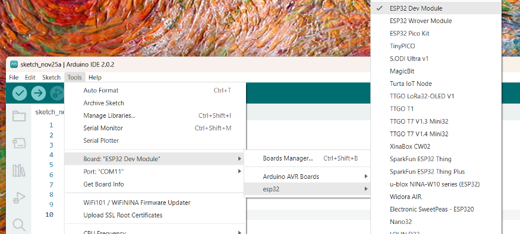
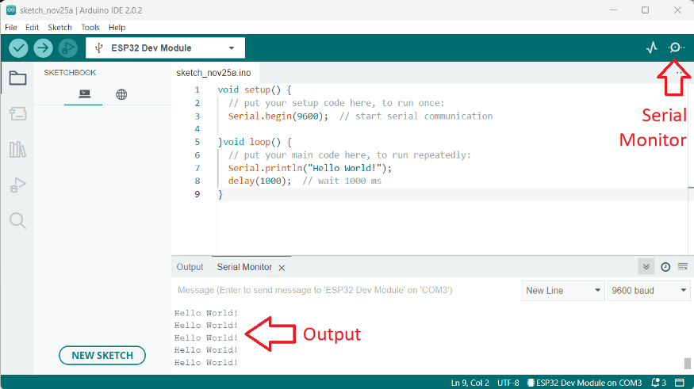
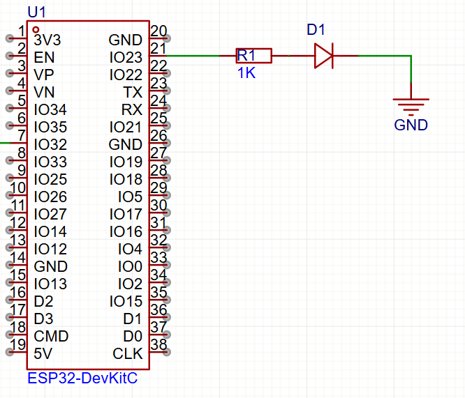
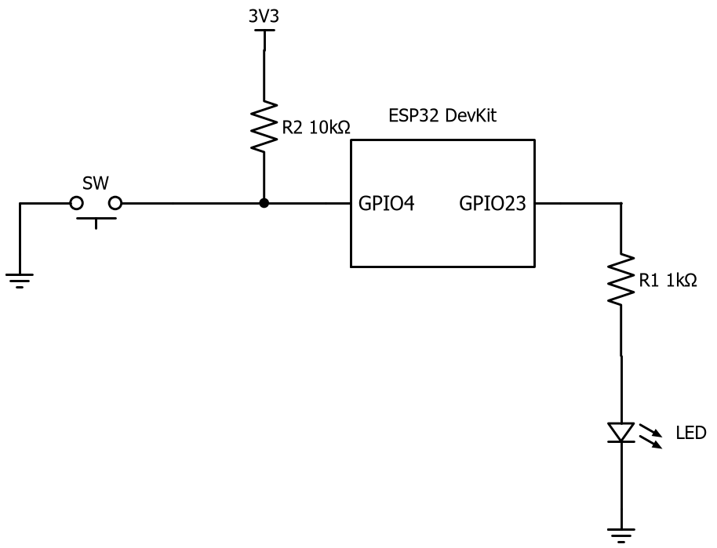
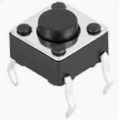
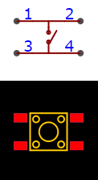
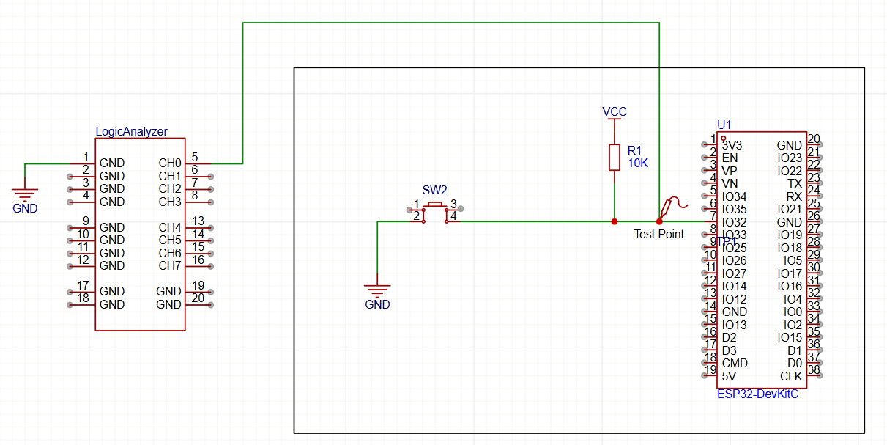
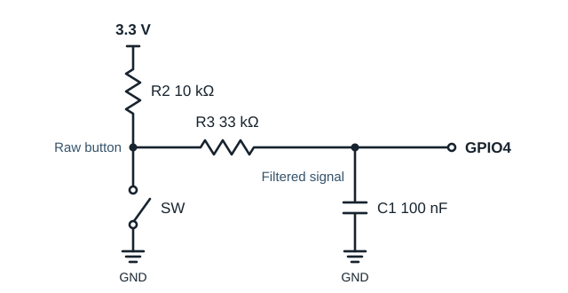

# LAB 1C — การต่อวงจรบนเบรดบอร์ดและเขียนโปรแกรมควบคุมด้วย ESP32

- [จุดประสงค์ของใบงาน](#จุดประสงค์ของใบงาน)
- [ปฏิบัติการ](#ปฏิบัติการ)
- [เครื่องมือที่ต้องใช้](#เครื่องมือที่ต้องใช้)
- [1.1 Hello World](#11-hello-world)
  - [ประเมินตนเอง](#ประเมินตนเอง)
- [1.2 ไฟกะพริบ](#12-ไฟกะพริบ)
  - [การใช้ชื่อแทนค่าคงที่](#การใช้ชื่อแทนค่าคงที่)
  - [ประเมินตนเอง](#ประเมินตนเอง-1)
- [1.3 ควบคุม LED ด้วยปุ่มกด](#13-ควบคุม-led-ด้วยปุ่มกด)
  - [1.3.1 กดปุ่มให้ LED ติด ปล่อยให้ดับ](#131-กดปุ่มให้-led-ติด-ปล่อยให้ดับ)
    - [ทำโปรแกรมต่อให้สมบูรณ์](#ทำโปรแกรมต่อให้สมบูรณ์)
    - [ทำความเข้าใจวงจร Pull-up และ Internal Pull-up](#ทำความเข้าใจวงจร-pull-up-และ-internal-pull-up)
  - [1.3.2 นับจำนวนครั้งที่กดปุ่ม](#132-นับจำนวนครั้งที่กดปุ่ม)
    - [เงื่อนไข](#เงื่อนไข)
  - [1.3.3 ดูสัญญาณ Bounce ก่อนและหลังใส่วงจร Debounce](#133-ดูสัญญาณ-bounce-ก่อนและหลังใส่วงจร-debounce)
    - [ใช้ Logic Analyzer ดูสัญญาณจากปุ่มกด](#ใช้-logic-analyzer-ดูสัญญาณจากปุ่มกด)
    - [ทดลองวงจร Debounce](#ทดลองวงจร-debounce)
    - [ประเมินตนเอง](#ประเมินตนเอง-2)
- [สิ่งที่ต้องส่ง](#สิ่งที่ต้องส่ง)

ในใบงานนี้ เราจะต่อวงจร LED และปุ่มกดบนเบรดบอร์ดด้วยตนเอง จากนั้นเขียนโปรแกรมบน ESP32 แล้วใช้ Logic Analyzer ดูสัญญาณจากวงจรที่ต่อจริง

Lab 1 มีสามใบงาน ให้ทำ [LAB 1A บน Wokwi](1A%20MCU%20wokwi.md) และ [LAB 1B บนบอร์ด GoGo CM](1B%20MCU%20GoGo%20CM%20board.md) ก่อนทำ LAB 1C เลขข้อเดียวกันหมายถึงกิจกรรมเดียวกัน เช่น ข้อ 1.3.2 เป็นการนับจำนวนครั้งที่กดปุ่มในทั้งสามใบงาน

## จุดประสงค์ของใบงาน

เมื่อทำครบทุกกิจกรรมแล้ว นักศึกษาควรทำสิ่งต่อไปนี้ได้

- ตั้งค่า Arduino IDE แล้วอัปโหลดโปรแกรมลงบอร์ด ESP32
- ต่อวงจร LED และปุ่มกดบนเบรดบอร์ด แล้วเขียนโปรแกรมโดยกำหนดขาอินพุตและเอาต์พุตได้ถูกต้อง
- อธิบายการทำงานของวงจร Pull-up, Internal Pull-up และ Pull-down
- ใช้ Logic Analyzer ดูสัญญาณจากปุ่มกด แล้วอธิบายว่าวงจร Debounce ช่วยลด Bounce ได้อย่างไร

## ปฏิบัติการ

- [1.1 Hello World](#11-hello-world)
- [1.2 ไฟกะพริบ](#12-ไฟกะพริบ)
- [1.3 ควบคุม LED ด้วยปุ่มกด](#13-ควบคุม-led-ด้วยปุ่มกด)

## เครื่องมือที่ต้องใช้

เตรียมบอร์ด ESP32 เบรดบอร์ด และโปรแกรม Arduino IDE ตาม[คู่มือการเตรียมอุปกรณ์และโปรแกรม](1%20MCU%20Setup.md) ใบงานนี้ใช้ GPIO23 สำหรับ LED และ GPIO4 สำหรับปุ่มกด เหมือนกับใน Wokwi ส่วนบอร์ด GoGo CM ใช้ IO6 สำหรับ LED เพราะใช้ชิปคนละรุ่น ดูรายละเอียดได้ใน[ใบงาน LAB 1B](1B%20MCU%20GoGo%20CM%20board.md)

## 1.1 Hello World

เริ่มจากอัปโหลดโปรแกรมที่ส่งข้อความ “Hello World!” จากบอร์ดมาแสดงใน Serial Monitor ขั้นตอนนี้ช่วยให้ตรวจได้ว่าคอมพิวเตอร์สื่อสารกับบอร์ดได้ก่อนเริ่มต่อวงจร

**เตรียมบอร์ดและตั้งค่า Arduino IDE**

1. ต่อสาย USB จากคอมพิวเตอร์เข้ากับบอร์ด ESP32 แล้วดูว่าไฟแสดงสถานะการจ่ายไฟบนบอร์ดติดหรือไม่
2. เปิด Arduino IDE หากยังไม่ได้ติดตั้งส่วนรองรับบอร์ด ESP32 ให้ทำตามคู่มือด้านบนก่อน
3. ไปที่เมนู **Tools → Board → esp32** แล้วเลือก **ESP32 Dev Module** ให้ตรงกับบอร์ดในชุด Lab
4. ไปที่เมนู **Tools → Port** แล้วเลือกพอร์ตของบอร์ด ถ้ามีหลายพอร์ต ให้ถอดสาย USB แล้วเสียบกลับเพื่อดูว่าพอร์ตไหนหายไปและกลับมา หมายเลขพอร์ตอาจเปลี่ยนได้เมื่อย้ายช่องเสียบ USB



**อัปโหลดโปรแกรมตัวอย่าง**

```cpp
void setup() {
  // put your setup code here, to run once:
  Serial.begin(9600);  // start serial communication
  
}

void loop() {
  // put your main code here, to run repeatedly:
  Serial.println("Hello World!");
  delay(1000);  // wait 1000 ms
}
```

เมื่ออัปโหลดเสร็จ ให้เปิด Serial Monitor แล้วตั้ง baud rate เป็น 9600 ควรเห็นข้อความ “Hello World!” ขึ้นบรรทัดใหม่ทุกวินาที



Arduino เรียก `setup()` ครั้งเดียวเมื่อบอร์ดเริ่มทำงาน จึงใช้ฟังก์ชันนี้สำหรับตั้งค่าเริ่มต้น ส่วน `loop()` จะทำงานซ้ำไปเรื่อย ๆ จึงเป็นส่วนที่ใช้สั่งให้โปรแกรมทำงานตามที่ต้องการ

ในตัวอย่างนี้ `Serial.begin(9600)` ตั้งอัตราการสื่อสารแบบอนุกรมไว้ที่ 9600 บิตต่อวินาที ส่วน `Serial.println()` ส่งข้อความออกมาพร้อมขึ้นบรรทัดใหม่ จึงเห็นข้อความแต่ละครั้งแยกกันใน Serial Monitor

### ประเมินตนเอง

- Serial Monitor แสดงข้อความ “Hello World!” ตามที่คาดไว้หรือไม่
- อธิบายได้ไหมว่าทำไมเราจึงเรียก `Serial.begin()` ใน `setup()` แต่เรียก `Serial.println()` ใน `loop()`

## 1.2 ไฟกะพริบ

ต่อ LED เข้ากับขา GPIO23 ตามภาพ ใช้ตัวต้านทานขนาด 100 Ω หรือ 1 kΩ ต่ออนุกรมกับ LED โดยให้ขาบวกของ LED (ขายาว) อยู่ทางฝั่ง GPIO23 และขาลบอยู่ทางฝั่งกราวด์ (GND)



อัปโหลดโปรแกรมด้านล่างแล้วสังเกตว่า LED ติดหนึ่งวินาทีและดับหนึ่งวินาทีสลับกันหรือไม่ ถ้าใช้ขาอื่น ให้แก้หมายเลขขาในโปรแกรมให้ตรงกับวงจรที่ต่อ

```cpp
void setup() {
  // initialize digital pin LED_BUILTIN as an output.
  pinMode(23, OUTPUT);
}

// the loop function runs over and over again forever
void loop() {
  digitalWrite(23, HIGH);   // turn the LED on 
  delay(1000);             // wait for a second
  digitalWrite(23, LOW);    // turn the LED off 
  delay(1000);             // wait for a second
}
```

คำสั่ง `pinMode(23, OUTPUT)` กำหนดให้ GPIO23 เป็นขาเอาต์พุต ส่วน `digitalWrite()` ใช้สั่งให้ขานี้เป็น `HIGH` หรือ `LOW` ตามจังหวะที่ต้องการ

### การใช้ชื่อแทนค่าคงที่

ลองใช้ `#define` ตั้งชื่อ `LED` แทนหมายเลขขา 23 และ `DELAY_TIME` แทนเวลาหน่วง 1,000 ms เมื่อกลับมาอ่านหรือแก้โปรแกรม จะเห็นได้ง่ายขึ้นว่าตัวเลขแต่ละตัวใช้ทำอะไร

```cpp
#define LED  23
#define DELAY_TIME  1000

void setup() {
  // initialize digital pin LED_BUILTIN as an output.
  pinMode(LED, OUTPUT);
}

// the loop function runs over and over again forever
void loop() {
  digitalWrite(LED, HIGH);   // turn the LED on 
  delay(DELAY_TIME);             // wait for a second
  digitalWrite(LED, LOW);    // turn the LED off 
  delay(DELAY_TIME);             // wait for a second
}
```

### ประเมินตนเอง

- ดูจากวงจรแล้วบอกได้ไหมว่าขาใดของ LED เป็นขาบวกและขาใดเป็นขาลบ ตัวต้านทานทำหน้าที่อะไร และถ้าเปลี่ยนค่าความต้านทาน ความสว่างจะเปลี่ยนอย่างไร
- ถ้าต่อ LED ดวงที่สองกับขา GPIO3 จะทำให้ไฟสองดวงติดสลับกันได้ไหมโดยใช้โปรแกรมเดิม ลองอธิบายเหตุผลจากคำสั่งที่กำหนดขาเอาต์พุต
- อธิบายได้ไหมว่า `pinMode()` กับ `digitalWrite()` ทำหน้าที่ต่างกันอย่างไร

## 1.3 ควบคุม LED ด้วยปุ่มกด

ข้อต่อไปจะเพิ่มปุ่มกดให้ควบคุม LED ได้ จากนั้นจะต่อยอดโปรแกรมเพื่อนับจำนวนครั้งที่กด และดูว่าสัญญาณจากปุ่มกดจริงมีผลกับการนับอย่างไร

### 1.3.1 กดปุ่มให้ LED ติด ปล่อยให้ดับ

ต่อปุ่มกดระหว่าง GPIO4 กับ GND แล้วต่อตัวต้านทาน Pull-up ขนาด 10 kΩ ระหว่าง GPIO4 กับ 3.3 V ตามภาพ ถ้าจะใช้ขาอื่น ให้ตรวจเอกสารข้อมูลของชิป (Datasheet) ก่อนว่าขานั้นใช้เป็นอินพุตได้



ก่อนเสียบปุ่มลงบนเบรดบอร์ด ให้ดูภาพด้านล่างว่าขาคู่ไหนต่อถึงกันอยู่แล้ว และขาคู่ไหนจะต่อถึงกันเมื่อกดปุ่ม





เริ่มจากโค้ดตัวอย่างด้านล่าง `pinMode(BUTTON, INPUT)` กำหนดให้ขาปุ่มเป็นอินพุต ส่วน `digitalRead(BUTTON)` อ่านค่าจากขานี้เป็น `HIGH` หรือ `LOW`

```cpp
#define LED     23
#define BUTTON  4

void setup() {
  pinMode(BUTTON, INPUT); // set arduino pin to input mode
  pinMode(LED, OUTPUT);  // set arduino pin to output mode
}

void loop() {
  if(digitalRead(BUTTON)==LOW) { 
    digitalWrite(LED, HIGH);
  }
}
```

#### ทำโปรแกรมต่อให้สมบูรณ์

โค้ดตัวอย่างสั่งให้ LED ติดเมื่อกดปุ่ม ลองเติมคำสั่งสำหรับตอนปล่อยปุ่ม แล้วทดสอบว่า LED ติดเฉพาะช่วงที่กดและดับทันทีที่ปล่อยหรือไม่

#### ทำความเข้าใจวงจร Pull-up และ Internal Pull-up

ตอนปล่อยปุ่ม ตัวต้านทาน Pull-up จะดึง GPIO4 ไว้ที่ `HIGH` เมื่อกดปุ่ม ขานี้จะต่อลง GND และอ่านได้ `LOW` ถ้าไม่มีตัวต้านทาน Pull-up ขณะปล่อยปุ่ม ขา GPIO4 จะลอยและอาจอ่านค่าได้ไม่แน่นอน

GPIO4 ของ ESP32 มีตัวต้านทาน Pull-up ภายใน (Internal Pull-up) ให้ใช้ ถ้าจะใช้แทนตัวต้านทานภายนอก ให้เปลี่ยนคำสั่งตั้งค่าขาปุ่มเป็นแบบด้านล่าง แล้วถอดตัวต้านทาน Pull-up ภายนอกออก

```cpp
pinMode(BUTTON, INPUT_PULLUP);
```

วิธีนี้ช่วยลดจำนวนชิ้นส่วนในวงจร หากเปลี่ยนไปใช้ขาอื่นหรือไมโครคอนโทรลเลอร์รุ่นอื่น ให้ตรวจเอกสารข้อมูลของชิปก่อนว่าขาที่เลือกมี Internal Pull-up ให้ใช้หรือไม่

### 1.3.2 นับจำนวนครั้งที่กดปุ่ม

ต่อยอดจากโปรแกรมข้อ 1.3.1 ให้เพิ่มค่าตัวนับทีละ 1 ทุกครั้งที่กดปุ่ม แล้วแสดงค่าที่นับได้ใน Serial Monitor

#### เงื่อนไข

ลองกดปุ่มค้างไว้เพื่อตรวจว่าโปรแกรมนับเพียงครั้งเดียว ค่าตัวนับควรเพิ่มอีกครั้งเมื่อปล่อยปุ่มแล้วกดใหม่ วิธีหนึ่งคือให้โปรแกรมตรวจว่าปล่อยปุ่มแล้วก่อนจะเริ่มนับการกดครั้งถัดไป

### 1.3.3 ดูสัญญาณ Bounce ก่อนและหลังใส่วงจร Debounce

เวลากดหรือปล่อยปุ่ม หน้าสัมผัสอาจแตะแล้วแยกออกจากกันหลายครั้งก่อนจะนิ่ง ช่วงสั้น ๆ นี้เรียกว่า Bounce สัญญาณที่ GPIO4 จึงอาจสลับระหว่าง `HIGH` กับ `LOW` หลายครั้ง ทั้งที่เรากดปุ่มเพียงครั้งเดียว

#### ใช้ Logic Analyzer ดูสัญญาณจากปุ่มกด

ต่อช่องวัดของ Logic Analyzer เข้ากับ GPIO4 และต่อ GND ของเครื่องมือร่วมกับ GND ของวงจร ลองกดและปล่อยปุ่ม แล้วขยายภาพสัญญาณตรงจังหวะที่ปุ่มเปลี่ยนสถานะเพื่อดู Bounce



ดูตัวอย่างการต่อ Logic Analyzer และการจับสัญญาณในวิดีโอด้านล่าง

[](https://www.youtube.com/watch?v=SLzTTlzXS5o)

#### ทดลองวงจร Debounce

ปิดไฟเลี้ยงก่อนแก้วงจร ให้คงตัวต้านทาน Pull-up R2 ขนาด 10 kΩ ไว้ระหว่าง 3.3 V กับจุดต่อปุ่มกด จากนั้นแทรกตัวต้านทาน R3 ขนาด 33 kΩ ระหว่างจุดต่อปุ่มกดกับ GPIO4 แล้วต่อตัวเก็บประจุ C1 ขนาด 100 nF ระหว่าง GPIO4 กับ GND ตามภาพ



ตั้งขาปุ่มเป็น `INPUT` เพราะวงจรมีตัวต้านทาน Pull-up ภายนอกอยู่แล้ว เมื่อกดปุ่มค้างไว้ C1 จะคายประจุผ่าน R3 จน GPIO4 อ่านได้ `LOW` เมื่อปล่อยปุ่ม C1 จะค่อย ๆ สะสมประจุผ่าน R2 และ R3 จน GPIO4 กลับมาอ่านได้ `HIGH`

ลองกดและปล่อยปุ่ม แล้ววัดสัญญาณที่ GPIO4 ซ้ำด้วย Logic Analyzer นำผลไปเทียบกับภาพก่อนใส่วงจร Debounce ถ้ามีช่องวัดเหลือ ให้ต่ออีกช่องที่จุดต่อปุ่มกดฝั่งก่อน R3 จะได้เปรียบเทียบสัญญาณก่อนและหลังกรองจากการกดครั้งเดียวกัน อย่าลืมต่อ GND ของเครื่องมือร่วมกับ GND ของวงจร

#### ประเมินตนเอง

- เวลากดปุ่มค้างไว้ โปรแกรมนับเพียงครั้งเดียวหรือไม่ และค่าตัวนับคงเดิมเมื่อปล่อยปุ่มหรือไม่
- ถ้าจะเปลี่ยนวงจรปุ่มจาก Pull-up เป็น Pull-down ต้องแก้การต่อสายและเงื่อนไขในโปรแกรมตรงไหน
- จากภาพ Logic Analyzer ชี้ได้ไหมว่า Bounce เกิดขึ้นช่วงไหน และอธิบายได้ไหมว่าทำไมโปรแกรมจึงอาจนับเกิน
- เมื่อเทียบภาพสัญญาณก่อนและหลังใส่วงจร Debounce แล้ว อธิบายได้ไหมว่าวงจรช่วยลด Bounce อย่างไร

## สิ่งที่ต้องส่ง

เรียงหลักฐานและคำตอบในรายงานตามเลขข้อด้านล่าง

1. **ข้อ 1.1 Hello World** ภาพหน้าจอ Serial Monitor ที่เห็นข้อความ “Hello World!”
2. **ข้อ 1.2 ไฟกะพริบ** ภาพถ่ายวงจร LED ที่ต่อกับ GPIO23
3. **ข้อ 1.3.1 กดปุ่มให้ LED ติด ปล่อยให้ดับ** ภาพถ่ายวงจรปุ่มกดที่ต่อกับ GPIO4 จะใช้ภาพเดียวกับข้อ 1.2 ได้ถ้าเห็นทั้งวงจร LED และวงจรปุ่มกดชัดเจน
4. **ข้อ 1.3.2 นับจำนวนครั้งที่กดปุ่ม** ภาพหน้าจอ Serial Monitor ที่แสดงค่าตัวนับจากการทดลองกดปุ่ม
5. **ข้อ 1.3.3 Bounce** ภาพจาก Logic Analyzer ที่แสดงสัญญาณที่ GPIO4 ก่อนและหลังใส่วงจร Debounce พร้อมอธิบายสั้น ๆ ว่าสัญญาณต่างกันอย่างไร

## สัญญาอนุญาต (License)


ผลงานนี้เผยแพร่ภายใต้สัญญาอนุญาต  
**Creative Commons Attribution–ShareAlike 4.0 International (CC BY-SA 4.0)**  
อนุญาตให้นำไปใช้ แก้ไข และเผยแพร่ต่อได้ โดยต้องระบุที่มา  
และเผยแพร่ภายใต้สัญญาอนุญาตเดียวกัน

โดย  
อ.ดร.อานันท์ สีห์พิทักษ์เกียรติ  
ภาควิชาวิศวกรรมคอมพิวเตอร์ คณะวิศวกรรมศาสตร์  
มหาวิทยาลัยเชียงใหม่

---

*เอกสารนี้ใช้ Opus 5.5 ในการสร้างเนื้อหาบางส่วน และตรวจสอบความถูกต้อง และความสอดคล้องระหว่าง Lab 1 ทั้ง 3 กิจกรรม ภายใต้การกำกับดูแลโดยผู้สอน*
